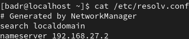
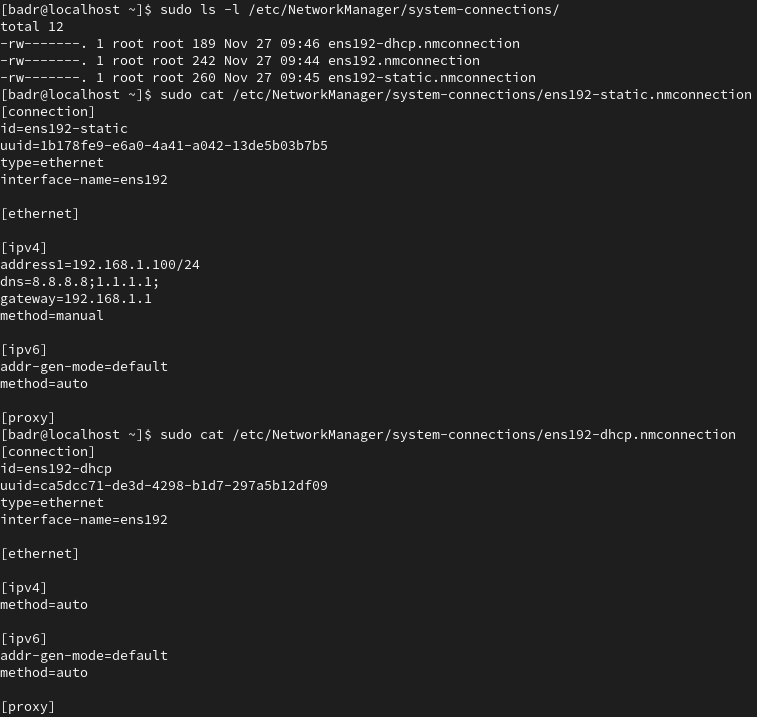
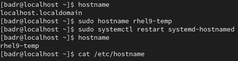
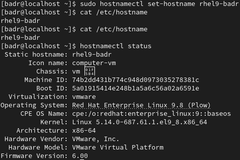
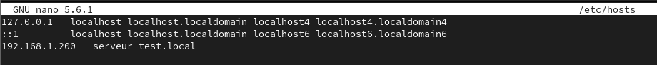
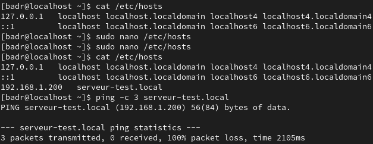

# TP n° 5 — Atelier 3 : Exploration des fichiers de configuration réseau

**École :** École Marocaine des Sciences de l'Ingénieur (EMSI)  
**Module :** Administration Unix — **Niveau :** 4IIR  
**Professeure :** Mme Berraho Sanae  
**Environnement :** Red Hat Enterprise Linux 9.8 (`RHEL 9 x86_64` — Interface `ens192`)  
**Utilisateur :** `badr@localhost` (`rhel9-badr`)  
**Compte rendu PDF :** [`Compte_Rendu_TP5_Atelier3_Config_Reseau.pdf`](./Compte_Rendu_TP5_Atelier3_Config_Reseau.pdf)  

---

## Objectif — Atelier3
Explorer les fichiers système clés qui gouvernent la configuration réseau et la résolution de noms sous Red Hat Enterprise Linux 9 : les serveurs DNS (/etc/resolv.conf), les fichiers de profils NetworkManager (/etc/NetworkManager/system-connections/), la gestion temporaire et permanente du nom d'hôte (hostname, hostnamectl, /etc/hostname) ainsi que la résolution locale statique (/etc/hosts).

---

## Étape 1 : Explorer le fichier `/etc/resolv.conf`

**Consigne :** Afficher le contenu du fichier /etc/resolv.conf pour observer les serveurs DNS utilisés par le système.

### Commande exécutée
```bash
cat /etc/resolv.conf
```

### Explication et Résultat
- Le fichier /etc/resolv.conf recense les serveurs DNS chargés de résoudre les noms de domaine en adresses IP (directives nameserver).
- L'en-tête # Generated by NetworkManager confirme que le fichier est géré automatiquement par NetworkManager (il est donc déconseillé de l'éditer manuellement afin d'éviter que les modifications ne soient écrasées).
- La configuration active issue du bail DHCP spécifie le domaine de recherche localdomain et le serveur DNS nameserver 192.168.27.2.

### Capture d'écran


---

## Étape 2 : Explorer `/etc/NetworkManager/system-connections/`

**Consigne :** Lister les fichiers de configuration des connexions NetworkManager et afficher leur contenu afin d'identifier les sections [connection], [ipv4] et [ipv6].

### Commandes exécutées
```bash
sudo ls -l /etc/NetworkManager/system-connections/
sudo cat /etc/NetworkManager/system-connections/ens192-static.nmconnection
sudo cat /etc/NetworkManager/system-connections/ens192-dhcp.nmconnection
```

### Explication et Résultat
- Sur RHEL 9, chaque profil créé via nmcli ou nmtui est stocké au format keyfile (.nmconnection) dans /etc/NetworkManager/system-connections/ avec des permissions strictes (-rw------- root:root) : on y retrouve ens192.nmconnection, ens192-static.nmconnection et ens192-dhcp.nmconnection.
- Dans ens192-static.nmconnection, la section [connection] indique id=ens192-static, l'UUID, type=ethernet et interface-name=ens192, tandis que [ipv4] enregistre method=manual, address1=192.168.1.100/24, gateway=192.168.1.1 et dns=8.8.8.8;1.1.1.1;.
- Dans ens192-dhcp.nmconnection, la section [ipv4] contient uniquement method=auto (et [ipv6] indique method=auto). Toute édition manuelle de ces fichiers impose un redémarrage du service via sudo systemctl restart NetworkManager.

### Capture d'écran


---

## Étape 3 : Configuration du nom d'hôte (`hostname` et `hostnamectl`)

**Consigne :** Afficher le nom d'hôte actuel, le modifier temporairement avec hostname et redémarrer systemd-hostnamed, puis le configurer de manière permanente avec hostnamectl et vérifier /etc/hostname.

### Commandes exécutées
```bash
hostname
sudo hostname rhel9-temp
sudo systemctl restart systemd-hostnamed
hostname
cat /etc/hostname
sudo hostnamectl set-hostname rhel9-badr
cat /etc/hostname
hostnamectl status
```

### Explication et Résultat
- Initialement, la commande hostname renvoie localhost.localdomain.
- Modification temporaire : sudo hostname rhel9-temp (suivi de sudo systemctl restart systemd-hostnamed) change immédiatement le nom d'hôte en mémoire vive (hostname retourne rhel9-temp), mais le fichier /etc/hostname reste vide — ce changement serait donc perdu au redémarrage.
- Modification permanente : sudo hostnamectl set-hostname rhel9-badr met à jour automatiquement /etc/hostname avec la valeur rhel9-badr.
- La commande hostnamectl status confirme Static hostname: rhel9-badr sur le système Red Hat Enterprise Linux 9.8 (Plow) (noyau Linux 5.14.0-687.61.1.el9_8.x86_64, virtualisation VMware).

### Captures d'écran




---

## Étape 4 : Résolution locale dans le fichier `/etc/hosts`

**Consigne :** Afficher /etc/hosts, y ajouter l'entrée associant 192.168.1.200 à serveur-test.local via nano, puis tester la résolution du nom d'hôte avec ping.

### Commandes exécutées
```bash
cat /etc/hosts
sudo nano /etc/hosts
# Ligne ajoutée :
# 192.168.1.200   serveur-test.local
cat /etc/hosts
ping -c 3 serveur-test.local
```

### Explication et Résultat
- Le fichier /etc/hosts associe statiquement des adresses IP à des noms d'hôtes locaux ; il est consulté en priorité par le système avant toute requête DNS externe.
- L'ajout de la ligne 192.168.1.200   serveur-test.local dans /etc/hosts avec nano est confirmé par cat /etc/hosts.
- Lors du test ping -c 3 serveur-test.local, la première ligne PING serveur-test.local (192.168.1.200) prouve que la résolution locale du nom d'hôte en adresse IP fonctionne immédiatement (les 100 % de paquets sans réponse sont normaux car aucune machine active n'utilise 192.168.1.200 sur le réseau).

### Captures d'écran




---

## Tableau récapitulatif — Atelier3

| Étape | Objectif | Commande clé | Résultat obtenu |
| :--- | :--- | :--- | :--- |
| **Étape 1** | Consulter les serveurs DNS actifs | `cat /etc/resolv.conf` | nameserver 192.168.27.2 (géré par NM) |
| **Étape 2** | Inspecter les fichiers .nmconnection | `sudo cat /etc/NetworkManager/system-connections/...` | Sections [connection], [ipv4], [ipv6] vérifiées |
| **Étape 3** | Changer le hostname (temp. puis perm.) | `hostname / sudo hostnamectl set-hostname rhel9-badr` | Static hostname rhel9-badr écrit dans /etc/hostname |
| **Étape 4** | Associer une IP locale dans /etc/hosts | `sudo nano /etc/hosts + ping serveur-test.local` | serveur-test.local résolu en 192.168.1.200 |
