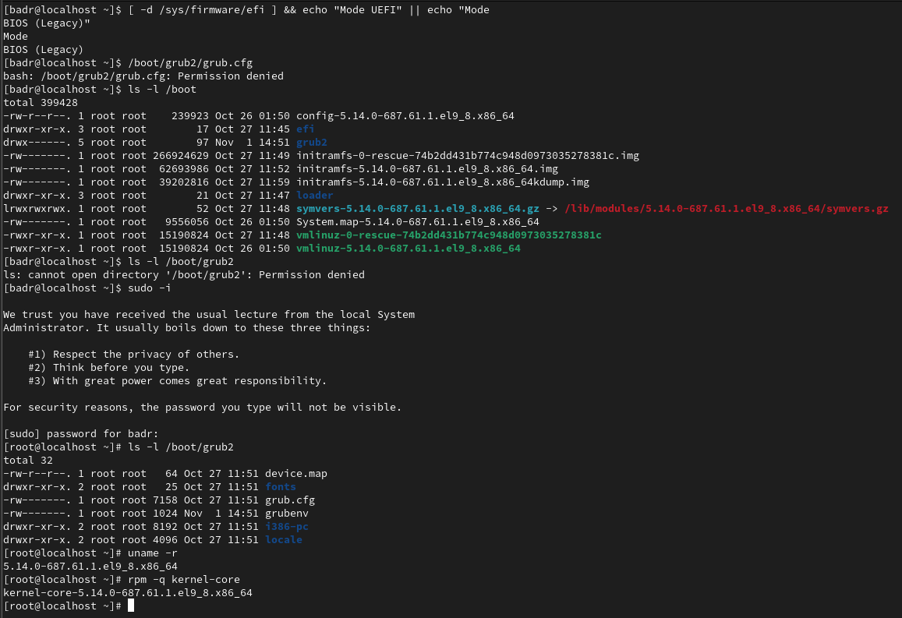
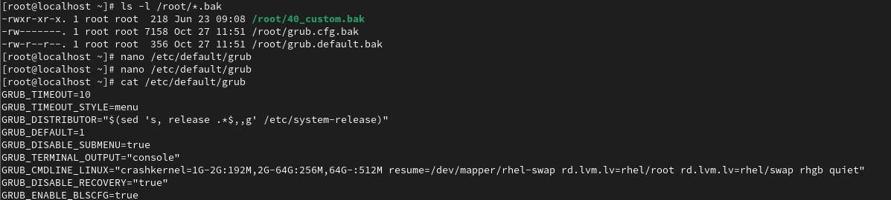
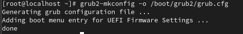
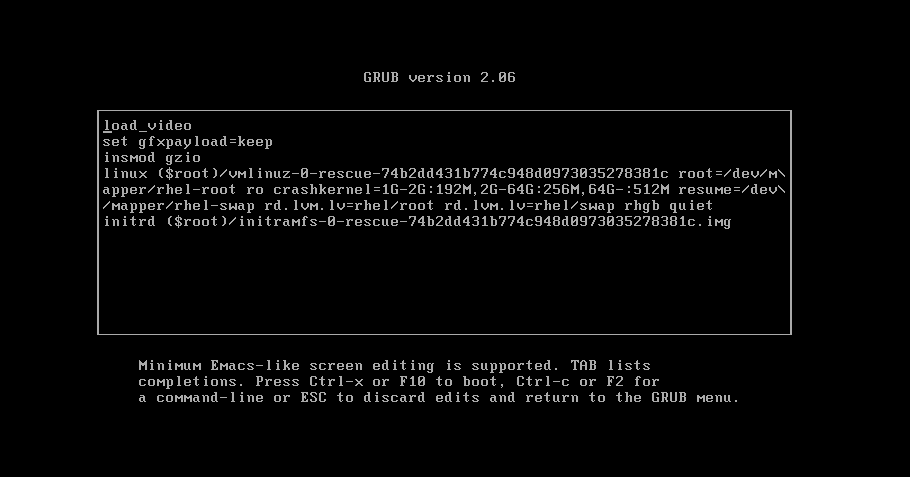
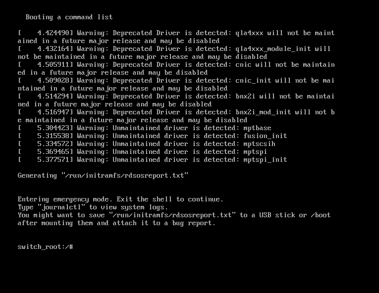
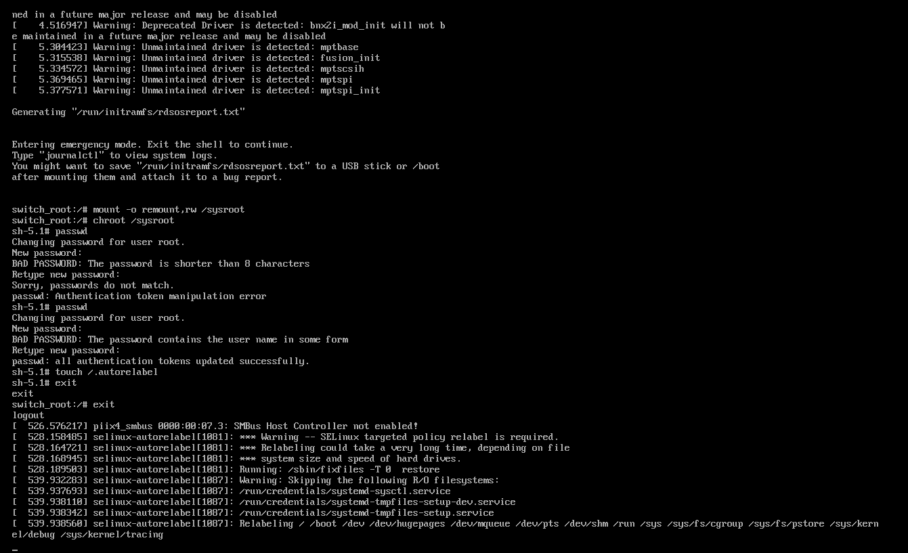
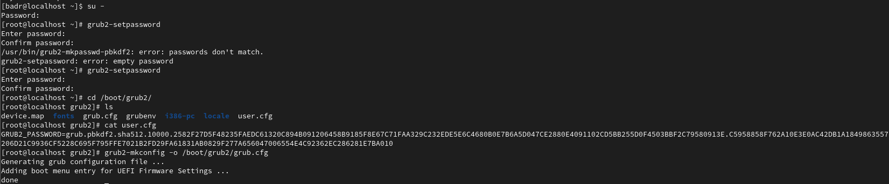
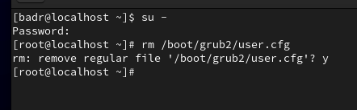

# TP n°2 : Configuration et Sécurisation du Chargeur de Démarrage GRUB2 (RHEL 9)

**Module :** Administration Unix  
**Filière :** 4IIR — EMSI  
**Encadrante :** Mr.Noreddine Abghour 
**Réalisé par :** Badr  
**Année universitaire :** 2026/2027  
**Système utilisé :** Red Hat Enterprise Linux 9.8 (`5.14.0-687.61.1.el9_8.x86_64`)

## Objectifs du TP

- Comprendre le rôle de **GRUB2** (*GRand Unified Bootloader version 2*) dans la séquence de démarrage de Linux.
- Identifier le mode de démarrage du système (**BIOS Legacy** vs **UEFI**) et l'architecture des fichiers dans `/boot`.
- Analyser le mécanisme de génération dynamique de `grub.cfg` via `/etc/default/grub`, `/etc/grub.d/` et la spécification **BLS** (*Boot Loader Specification*).
- Personnaliser le comportement de GRUB2 (délai d'affichage à 10 secondes, entrée par défaut, ajout d'entrées personnalisées `reboot` et `halt`).
- Réinitialiser un mot de passe `root` oublié en interrompant le démarrage avec `rd.break` et en gérant le contexte **SELinux** (`/.autorelabel`).
- Sécuriser l'interface GRUB2 par mot de passe chiffré (**PBKDF2-SHA512**) avec `grub2-setpassword`.

## Architecture de Démarrage et Génération de GRUB2

```
+-----------------------------------------------------------------------+
|                     SÉQUENCE DE DÉMARRAGE LINUX                       |
+-----------------------------------------------------------------------+
|  [1. Firmware : BIOS / UEFI]                                          |
|         |                                                             |
|         v                                                             |
|  [2. Bootloader : GRUB2] ---> Lit /boot/grub2/grub.cfg                |
|         |                     & /boot/loader/entries/*.conf (BLS)     |
|         v                                                             |
|  [3. Noyau (vmlinuz) + Disque RAM initial (initramfs.img)]            |
|         |  (Point d'interception : paramètre noyau "rd.break")        |
|         v                                                             |
|  [4. Montage de /sysroot -> Pivot Root -> Lancement de systemd]       |
+-----------------------------------------------------------------------+

+-----------------------------------------------------------------------+
|                   GÉNÉRATION DU FICHIER grub.cfg                      |
+-----------------------------------------------------------------------+
|  /etc/default/grub  (Variables globales)   \                          |
|  /etc/grub.d/*      (Scripts exécutables)   +--> [grub2-mkconfig]     |
|  /boot/grub2/user.cfg (Mot de passe haché) /            |             |
|                                                         v             |
|                                              /boot/grub2/grub.cfg     |
+-----------------------------------------------------------------------+
```

## Partie 1 : Découverte de GRUB2 et du Processus de Démarrage

### 1. Rôle de GRUB2 dans la séquence de démarrage

Lors de la mise sous tension, le firmware de la machine (**BIOS** ou **UEFI**) initialise le matériel, puis exécute le chargeur de démarrage **GRUB2**. Ce dernier remplit trois missions critiques :
1. Afficher le menu interactif permettant de choisir le noyau ou le système d'exploitation à lancer.
2. Charger en mémoire vive (RAM) le noyau Linux compressé (`vmlinuz`) ainsi que le système de fichiers racine temporaire (`initramfs`).
3. Transférer le contrôle d'exécution au noyau en lui passant ses arguments de démarrage (ligne de commande du noyau).

### 2. Identification du mode de démarrage (BIOS ou UEFI)

L'emplacement de la configuration de GRUB2 dépend du firmware utilisé. Pour vérifier le mode actif sur notre station RHEL 9 :

```bash
[ -d /sys/firmware/efi ] && echo "Mode UEFI" || echo "Mode BIOS (Legacy)"
```

**Sortie obtenue sur notre machine :**

```text
Mode BIOS (Legacy)
```

**Emplacements des fichiers selon le mode :**

| Mode de démarrage | Chemin du fichier `grub.cfg` | Particularité sur RHEL 9 |
| :--- | :--- | :--- |
| **BIOS (Legacy)** | `/boot/grub2/grub.cfg` | Fichier principal de configuration lu directement par GRUB2. |
| **UEFI** | `/boot/efi/EFI/redhat/grub.cfg` | Fichier relais (stub) qui redirige automatiquement vers `/boot/grub2/grub.cfg`. |

### 3 & 4. Exploration de `/boot`, `/boot/grub2` et identification des noyaux

Commandes exécutées (en tant que `root` via `sudo -i`, car `/boot/grub2` possède les permissions `drwx------` réservées à `root`) :

```bash
ls -l /boot
ls -l /boot/grub2
uname -r
rpm -q kernel-core
```

**Capture d'écran des résultats obtenus (Partie 1) :**



**Analyse des composants clés de `/boot` :**

| Élément | Rôle technique détaillé |
| :--- | :--- |
| `vmlinuz-5.14.0-687.61.1.el9_8.x86_64` | Image exécutable compressée du noyau Linux (*Virtual Memory LINUx gZipped*). |
| `initramfs-5.14.0-687.61.1.el9_8.x86_64.img` | Archive *Initial RAM FileSystem* montée en mémoire au démarrage. Elle contient les pilotes matériels essentiels (stockage, LVM, systèmes de fichiers) nécessaires pour monter la vraie partition racine `/`. |
| `loader/entries/` | Répertoire contenant un fichier `.conf` par noyau installé, au standard **BLS** (*Boot Loader Specification*). |
| `grub2/grubenv` | Fichier de bloc de 1024 octets pré-alloué qui stocke les variables persistantes de GRUB2 (comme `saved_entry`). |
| `grub2/grub.cfg` | Fichier de configuration final interprété par GRUB2 au démarrage (ne jamais modifier directement). |
| `grub2/i386-pc` | Répertoire contenant les modules GRUB2 propres à l'architecture BIOS (Legacy). |

## Partie 2 : Analyse de la Configuration de GRUB2

Le fichier `/boot/grub2/grub.cfg` est généré automatiquement par l'utilitaire `grub2-mkconfig` en combinant :
1. Les variables globales définies dans `/etc/default/grub`.
2. Les scripts modulaires situés dans `/etc/grub.d/`.

### 1. Analyse du fichier `/etc/default/grub`

```bash
cat /etc/default/grub
```

| Variable | Rôle et comportement |
| :--- | :--- |
| `GRUB_TIMEOUT` | Durée (en secondes) d'affichage du menu avant le lancement automatique de l'entrée par défaut. |
| `GRUB_DISTRIBUTOR` | Commande shell extrayant le nom de la distribution depuis `/etc/system-release` pour préfixer les titres du menu. |
| `GRUB_DEFAULT` | Définit l'entrée sélectionnée par défaut (`0` pour la 1re entrée, `1` pour la 2e, ou `saved` pour lire la variable `saved_entry` dans `/boot/grub2/grubenv`). |
| `GRUB_DISABLE_SUBMENU` | Lorsque défini à `true`, affiche tous les noyaux directement dans le menu principal sans les regrouper dans un sous-menu. |
| `GRUB_TERMINAL_OUTPUT` | Mode d'affichage de l'interface GRUB (`console` texte standard, `serial` port série, ou `gfxterm` mode graphique). |
| `GRUB_CMDLINE_LINUX` | Arguments passés au noyau Linux au démarrage (`crashkernel=...`, `resume=/dev/mapper/rhel-swap`, `rd.lvm.lv=rhel/root`, `rhgb quiet`). |
| `GRUB_DISABLE_RECOVERY` | Si `true`, empêche la génération automatique des entrées de dépannage (*recovery*) pour chaque noyau. |
| `GRUB_ENABLE_BLSCFG` | Si `true`, active le standard **BLS** : `grub.cfg` délègue la déclaration des noyaux aux fichiers individuels de `/boot/loader/entries/`. |

### 2. Analyse des scripts du répertoire `/etc/grub.d/`

```bash
ls -l /etc/grub.d/
```

| Script | Fonction dans la génération de `grub.cfg` |
| :--- | :--- |
| `00_header` | Configure l'en-tête de `grub.cfg` : charge `/boot/grub2/grubenv`, applique `GRUB_DEFAULT`, `GRUB_TIMEOUT` et configure le terminal. |
| `01_users` | Configure le superutilisateur `root` de GRUB2 et importe le mot de passe haché depuis `/boot/grub2/user.cfg` s'il existe. |
| `10_linux` | Génère les entrées de démarrage des noyaux Linux. Sur RHEL 9, il appelle la directive `blscfg` pour charger les fichiers de `/boot/loader/entries/`. |
| `30_uefi-firmware` | Ajoute l'entrée permettant d'accéder à la configuration du firmware UEFI. |
| `40_custom` | Script destiné à l'ajout d'entrées de menu personnalisées (`menuentry`), copiées telles quelles à la fin de `grub.cfg`. |

## Partie 3 : Génération et Modification de la Configuration de GRUB2

### 1, 2 & 3. Sauvegarde des fichiers et modification de `/etc/default/grub`

Sauvegarde préventive avec conservation des attributs (`cp -p`) et modification des paramètres globaux (`GRUB_TIMEOUT=10`, `GRUB_TIMEOUT_STYLE=menu`, `GRUB_DEFAULT=1`) :

```bash
cp -p /etc/default/grub /root/grub.default.bak
cp -p /etc/grub.d/40_custom /root/40_custom.bak
cp -p /boot/grub2/grub.cfg /root/grub.cfg.bak
nano /etc/default/grub
cat /etc/default/grub
```

**Capture d'écran des sauvegardes et du fichier `/etc/default/grub` modifié :**



### 4. Ajout des entrées personnalisées (Redémarrer et Arrêter)

Édition du script `/etc/grub.d/40_custom` avec `nano /etc/grub.d/40_custom` :

```bash
#!/bin/sh
exec tail -n +3 $0
# This file provides an easy way to add custom menu entries.  Simply type the
# menu entries you want to add after this comment.  Be careful not to change
# the 'exec tail' line above.

menuentry "Redemarrer" {
    echo "Redemarrer le systeme..."
    reboot
}
menuentry "Arreter le systeme" {
    echo "Arret du systeme..."
    halt
}
```

### 5. Régénération du fichier `grub.cfg`

Compilation des modifications dans `/boot/grub2/grub.cfg` :

```bash
grub2-mkconfig -o /boot/grub2/grub.cfg
```

**Capture d'écran de la régénération de `grub.cfg` :**



## Partie 4 : Réinitialisation du Mot de Passe `root` (Dépannage)

Lorsqu'un administrateur perd le mot de passe `root`, GRUB2 permet d'interrompre le démarrage avant le passage de relais à `systemd`.

### 1 & 2. Édition de l'entrée GRUB2 (touche `e`) et ajout de `rd.break`

Au menu de démarrage GRUB2, on appuie sur **`e`** pour éditer l'entrée du noyau Linux, puis on ajoute `rd.break` à la fin de la ligne commençant par `linux` (après `rhgb quiet`) avant de démarrer avec **`Ctrl + X`**.

**Capture d'écran de l'interface d'édition de GRUB2 :**



### 3. Interruption du démarrage dans le shell d'urgence (`switch_root:/#`)

Le paramètre `rd.break` interrompt le processus de démarrage dans `initramfs` juste avant que le contrôle ne soit passé à `systemd` :



### 4, 5, 6 & 7. Remontage de `/sysroot`, `chroot`, changement du mot de passe et ré-étiquetage SELinux

Commandes exécutées dans le shell `switch_root:/#` :

```bash
mount -o remount,rw /sysroot
chroot /sysroot
passwd
touch /.autorelabel
exit
exit
```

**Capture d'écran de la réinitialisation du mot de passe `root` et du ré-étiquetage automatique SELinux :**



**Explication technique essentielle :**
- `mount -o remount,rw /sysroot` remonte la vraie partition racine en lecture/écriture (car elle est montée en lecture seule par défaut dans `initramfs`).
- `chroot /sysroot` change la racine active pour que `passwd` modifie directement `/etc/shadow` du système RHEL 9.
- `touch /.autorelabel` est indispensable car `passwd` recrée `/etc/shadow` sans contexte SELinux : au redémarrage, `selinux-autorelabel` exécute `/sbin/fixfiles -T 0 restore` pour restaurer le contexte SELinux de `/etc/shadow` et permettre l'ouverture de session `root`.

## Partie 5 : Protection de l'Interface GRUB2 par Mot de Passe

### 1. Pourquoi protéger GRUB2 ?

- **Empêcher l'accès au mode mono-utilisateur (`rd.break` / single user)** qui donne un accès `root` complet sans mot de passe.
- **Empêcher l'accès à la console interactive `grub>`** permettant de lire des fichiers avec `cat` ou de modifier les paramètres du noyau.
- **Empêcher le démarrage d'un système d'exploitation non sécurisé** en environnement dual-boot.

### 2. Création et vérification du mot de passe chiffré (`user.cfg`)

Exécution de `grub2-setpassword`, vérification de `/boot/grub2/user.cfg` (condensat **PBKDF2-SHA512**) et régénération de `grub.cfg` :

```bash
grub2-setpassword
cd /boot/grub2/
ls
cat user.cfg
grub2-mkconfig -o /boot/grub2/grub.cfg
```

**Capture d'écran de la création de `user.cfg` et de la régénération de `grub.cfg` :**



Après redémarrage (`reboot`), l'appui sur la touche **`e`** dans le menu GRUB2 exige désormais le nom d'utilisateur (`root`) et le mot de passe défini via `grub2-setpassword`.

### 3. Suppression de la protection par mot de passe

Suppression du fichier `/boot/grub2/user.cfg` :

```bash
rm /boot/grub2/user.cfg
```

**Capture d'écran de la suppression de `user.cfg` :**



## Aide-Mémoire Récapitulatif des Commandes du TP

| Action | Commande exacte |
| :--- | :--- |
| Vérifier le mode BIOS ou UEFI | `[ -d /sys/firmware/efi ] && echo "Mode UEFI" \|\| echo "Mode BIOS (Legacy)"` |
| Lister le contenu de `/boot` et `/boot/grub2` | `ls -l /boot` et `ls -l /boot/grub2` |
| Afficher le noyau actif en mémoire | `uname -r` |
| Lister tous les noyaux installés | `rpm -q kernel-core` |
| Afficher les paramètres globaux GRUB2 | `cat /etc/default/grub` |
| Lister les scripts générateurs GRUB2 | `ls -l /etc/grub.d/` |
| Sauvegarder les fichiers avant modification | `cp -p /etc/default/grub /root/grub.default.bak`<br>`cp -p /etc/grub.d/40_custom /root/40_custom.bak`<br>`cp -p /boot/grub2/grub.cfg /root/grub.cfg.bak` |
| Régénérer le fichier `grub.cfg` | `grub2-mkconfig -o /boot/grub2/grub.cfg` |
| Remonter `/sysroot` en lecture/écriture (`rd.break`) | `mount -o remount,rw /sysroot` |
| Basculer la racine dans `/sysroot` | `chroot /sysroot` |
| Forcer le ré-étiquetage SELinux au prochain boot | `touch /.autorelabel` |
| Définir un mot de passe GRUB2 (`user.cfg`) | `grub2-setpassword` |
| Supprimer le mot de passe GRUB2 | `rm /boot/grub2/user.cfg` |
