# TP N° 3 : Configuration des cibles, gestion des services par Systemd et journalisation avec Journalctl

| Informations | Détails |
| :--- | :--- |
| **Établissement** | École Marocaine des Sciences de l'Ingénieur (EMSI) |
| **Module** | Administration Unix |
| **Filière** | 4IIR |
| **Encadrant Pédagogique** | Mr. Noreddine Abghour |
| **Système d'exploitation** | Red Hat Enterprise Linux 9.8 (Plow) — Kernel `5.14.0-687.61.1.el9_8.x86_64` |
| **Version Systemd** | `systemd 252 (252-67.el9_8.6)` (`badr@localhost`) |

## Fichiers du Dossier

- [`Compte_Rendu_TP3_Systemd.pdf`](./Compte_Rendu_TP3_Systemd.pdf) : Compte-rendu complet au format PDF.
- [`Compte_Rendu_TP3_Systemd.docx`](./Compte_Rendu_TP3_Systemd.docx) : Compte-rendu éditable au format Word (`.docx`).
- [`Enonce_TP3_Systemd.pdf`](./Enonce_TP3_Systemd.pdf) : Énoncé officiel du TP n°3.
- [`screenshots/`](./screenshots/) : Dossier regroupant les 26 captures d'écran numérotées par atelier.

## Synthèse Exécutive des Ateliers Réalisés

| Atelier | Domaine Technique | Commandes Clés Validées | Résultat Observé sur RHEL 9.8 |
| :--- | :--- | :--- | :--- |
| **Atelier 1** | Bases & Analyse du Boot | `systemctl --version`, `ps aux`, `whereis`, `systemd-analyze [blame \| critical-chain]` | Systemd v252 en PID 1 ; démarrage complet en 19.215s (`graphical.target` à 12.188s). |
| **Atelier 2** | Cibles (Targets) | `systemctl get-default`, `list-units`, `set-default`, `isolate`, `--failed`, `is-enabled`, `status` | 22 cibles actives ; bascule dynamique entre `graphical.target` et `multi-user.target` ; 0 unité en échec. |
| **Atelier 3** | Gestion des Services | `systemctl list-unit-files`, `restart`, `reload`, `disable`, `enable`, `mask`, `unmask`, `kill` | Rechargement SSH sans coupure (`SIGHUP`) ; masquage `httpd` vers `/dev/null` ; arrêt propre `SIGTERM`. |
| **Atelier 4** | Journalisation (`journalctl`) | `journalctl -b`, `-u`, `-f`, `-p [err\|warning]`, `--since`, `-n`, `-o [cat\|json-pretty]` | Filtrage par boot, service, gravité et plage horaire ; export JSON enrichi avec contexte SELinux et cgroups. |

---

## Atelier 1 : Architecture de Systemd et Analyse des Performances d'Amorçage

### 1.1 Identification de la version et des capacités compilées de Systemd

```bash
systemctl --version
```

**Analyse :** La commande interroge le binaire `systemctl` afin d'afficher la version exacte de la suite `systemd` ainsi que les modules de sécurité et de compression activés lors de sa compilation par Red Hat. Sur notre système RHEL 9.8, la version installée est `systemd 252 (252-67.el9_8.6)` avec le support natif de `PAM`, `AUDIT`, `SELINUX`, `OPENSSL`, `ACL`, `BLKID`, `ZSTD` et la hiérarchie unifiée cgroups v2 (`default-hierarchy=unified`).

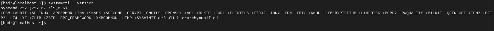

### 1.2 Vérification du processus maître d'initialisation (PID 1)

```bash
ps aux | head -2
```

**Analyse :** Sous Unix/Linux, le premier processus lancé en espace utilisateur par le noyau porte le PID 1. L'inspection de la table des processus confirme que le PID 1 correspond à l'exécutable `/usr/lib/systemd/systemd` invoqué avec les arguments `--switched-root --system --deserialize 28 rhgb` (après basculement depuis le disque RAM initial `initramfs` vers la racine réelle du système).

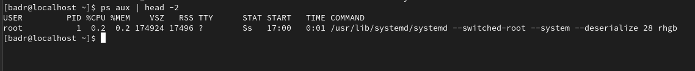

### 1.3 Localisation des binaires, bibliothèques et pages de manuel

```bash
whereis systemd
whereis systemctl
```

**Analyse :** La commande `whereis` localise les fichiers binaires, les répertoires de configuration et la documentation associée. Les bibliothèques et unités système résident dans `/usr/lib/systemd` et `/usr/lib64/systemd`, la configuration locale propre à l'administrateur se trouve dans `/etc/systemd`, et l'outil de contrôle utilisateur est placé dans `/usr/bin/systemctl`.

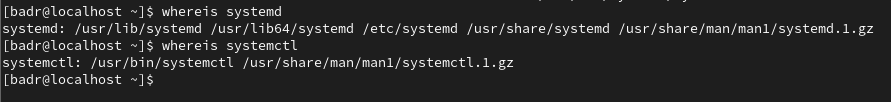

### 1.4 Mesure globale du temps de démarrage du système

```bash
systemd-analyze
```

**Analyse :** L'outil `systemd-analyze` décompose la durée totale d'amorçage (`19.215s`) en trois phases distinctes : l'initialisation du noyau Linux (`3.743s` dans `kernel`), le chargement des pilotes préliminaires en mémoire vive (`3.245s` dans `initrd`), et le démarrage des services en espace utilisateur (`12.226s` dans `userspace`). La cible graphique `graphical.target` est atteinte au bout de `12.188s` en espace utilisateur.

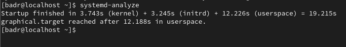

### 1.5 Classement des unités selon leur durée d'initialisation (`blame`)

```bash
systemd-analyze blame
```

**Analyse :** L'option `blame` trie l'ensemble des unités activées par ordre décroissant du temps passé à s'initialiser. On observe que `plymouth-quit-wait.service` (`6.035s`), `kdump.service` (`4.994s`) et `sys-module-fuse.device` (`3.668s`) représentent les opérations les plus longues lors de la montée en charge.

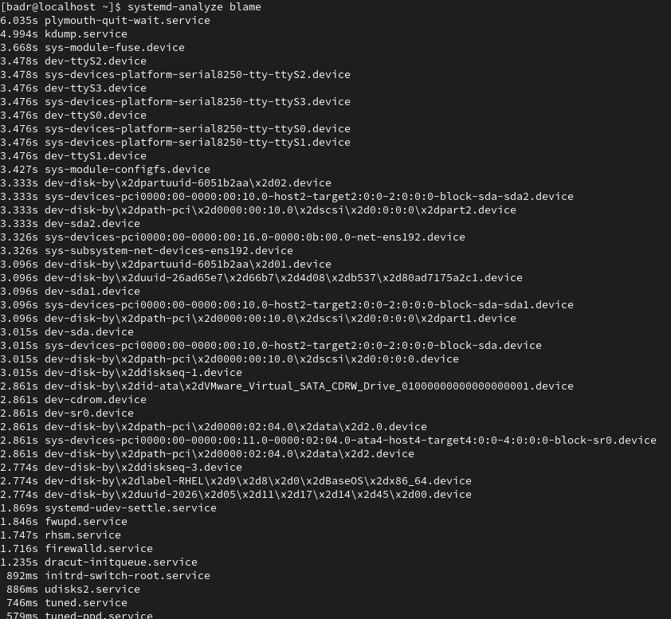

### 1.6 Analyse de l'arbre de la chaîne critique (`critical-chain`)

```bash
systemd-analyze critical-chain
```

**Analyse :** Contrairement à `blame` qui liste les durées individuelles même parallélisées, `critical-chain` reconstitue la chaîne de dépendances séquentielles ayant directement déterminé le temps final d'atteinte de `graphical.target` (`@12.188s`). Les unités affichées en rouge signalent le temps d'activation (`+6.035s` pour `plymouth-quit-wait.service`, `+93ms` pour `systemd-user-sessions.service`, `+74ms` pour `dbus-broker.service`, `+148ms` pour `systemd-tmpfiles-setup.service`).

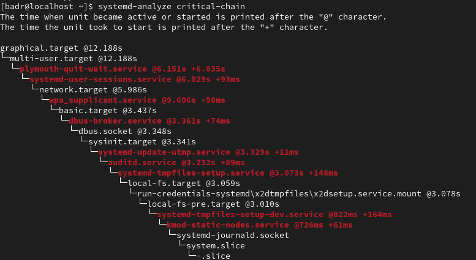

---

## Atelier 2 : Configuration et Administration des Cibles Systemd (Targets)

### 2.1 Consultation de la cible par défaut au démarrage

```bash
systemctl get-default
```

**Analyse :** La commande `systemctl get-default` lit le lien symbolique `/etc/systemd/system/default.target` pour indiquer quelle cible systemd active automatiquement à la fin de l'amorçage. Initialement, la station est configurée sur `graphical.target` (équivalent de l'ancien runlevel 5).

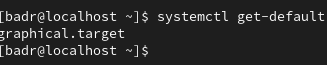

### 2.2 Inventaire des unités de cibles actuellement chargées

```bash
systemctl list-units --type target
```

**Analyse :** Cette commande répertorie les 22 cibles actives en mémoire dans la session courante : `basic.target`, `cryptsetup.target`, `getty.target`, `graphical.target`, `local-fs.target`, `multi-user.target`, `network-online.target`, `sockets.target`, `swap.target`, `sysinit.target` et `timers.target`.

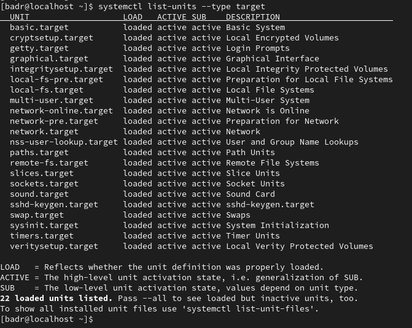

### 2.3 Modification de la cible par défaut vers `multi-user.target`

```bash
sudo systemctl set-default multi-user.target
systemctl get-default
```

**Analyse :** L'exécution de `set-default multi-user.target` supprime le lien symbolique `/etc/systemd/system/default.target` et le recrée en pointant vers `/usr/lib/systemd/system/multi-user.target` (mode console multi-utilisateurs avec réseau, sans serveur d'affichage graphique). L'appel suivant à `get-default` confirme la prise en compte immédiate du changement.

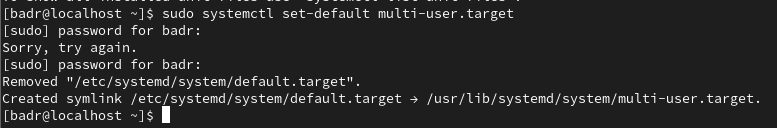

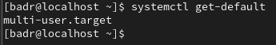

### 2.4 Basculement dynamique de la session (`isolate`) et retour au bureau graphique

```bash
sudo systemctl isolate multi-user.target
# Puis depuis la console texte tty2 :
sudo systemctl set-default graphical.target
sudo systemctl isolate graphical.target
```

**Analyse :** La sous-commande `isolate` applique immédiatement une cible en arrêtant tous les services qui n'en dépendent pas. Le passage à `multi-user.target` coupe le gestionnaire d'affichage GDM/GNOME et place la machine sur l'invite de connexion texte `tty2` (`Red Hat Enterprise Linux 9.8 Plow`). Après connexion de l'utilisateur `badr` en mode console, nous restaurons `graphical.target` comme cible par défaut et relançons l'environnement graphique à chaud via `systemctl isolate graphical.target`.

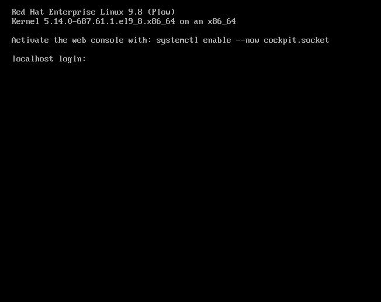

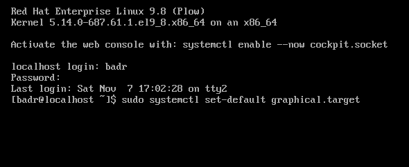

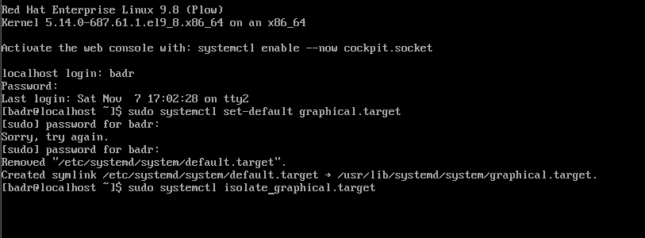

### 2.5 Contrôle des unités en échec et vérification des services SSH et Cron

```bash
systemctl --failed
systemctl is-enabled sshd.service
systemctl status crond.service
```

**Analyse :**
1. `systemctl --failed` vérifie qu'aucune unité n'est tombée en état d'erreur (`0 loaded units listed`).
2. `systemctl is-enabled sshd.service` confirme que le serveur OpenSSH est configuré pour démarrer automatiquement (`enabled`).
3. `systemctl status crond.service` affiche l'état détaillé du planificateur de tâches : actif (`active (running)` depuis 27 min), PID principal `1299`, consommation mémoire de `1.0M` dans le groupe de contrôle `/system.slice/crond.service`.

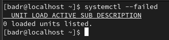

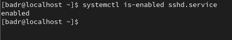

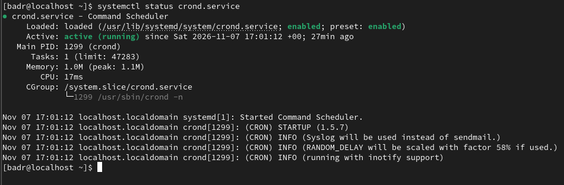

---

## Atelier 3 : Gestion du Cycle de Vie des Services par Systemctl

### 3.1 Inventaire des fichiers d'unités de type service

```bash
systemctl list-unit-files --type=service
```

**Analyse :** La commande affiche tous les fichiers `.service` installés dans `/usr/lib/systemd/system` et `/etc/systemd/system`, accompagnés de leur état configuré (`STATE` : `enabled`, `disabled`, `static`, `alias`) et de la recommandation d'usine du distributeur Red Hat (`PRESET`).

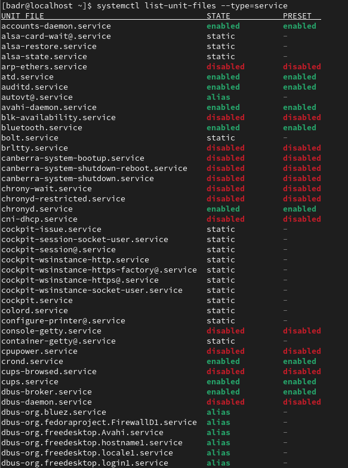

### 3.2 Redémarrage, rechargement à chaud et statut du démon OpenSSH

```bash
sudo systemctl restart sshd.service
sudo systemctl reload sshd.service
systemctl status sshd.service
```

**Analyse :** La commande `restart` arrête puis relance le service en lui attribuant un nouveau PID (`Main PID 5609`). En revanche, `reload` demande au service de relire ses fichiers de configuration sans interrompre le processus principal ni couper les connexions actives : systemd exécute `ExecReload=/bin/kill -HUP $MAINPID` (`code=exited, status=0/SUCCESS`). Le journal intégré confirme la réception du signal `SIGHUP` et l'écoute active sur le port TCP 22 (IPv4 et IPv6).

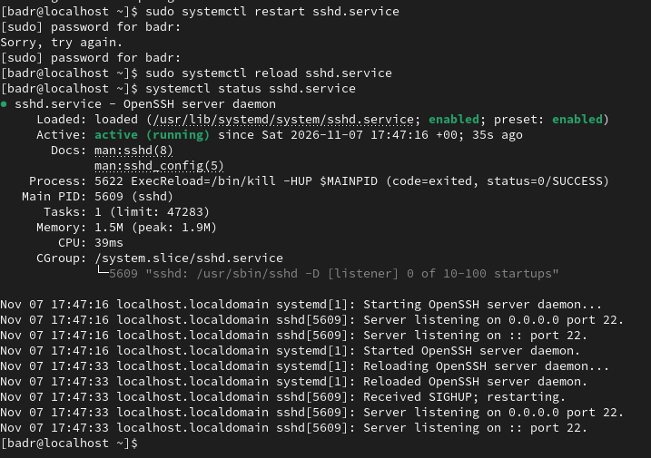

### 3.3 Vérification d'activité, désactivation et réactivation au boot de `crond`

```bash
systemctl is-active crond.service
sudo systemctl disable crond.service
systemctl is-enabled crond.service
sudo systemctl enable crond.service
```

**Analyse :** La commande `is-active` vérifie l'état d'exécution instantané (`active`). L'action `disable` supprime le lien symbolique `/etc/systemd/system/multi-user.target.wants/crond.service` afin d'empêcher le lancement automatique au prochain démarrage (confirmé par `is-enabled` qui retourne `disabled`), sans arrêter le processus en cours. Enfin, `enable` recrée le lien symbolique.

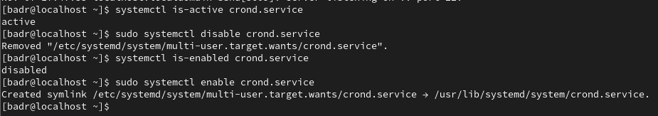

### 3.4 Masquage et démasquage d'une unité de service (`mask` / `unmask`)

```bash
sudo systemctl mask httpd.service
ls -l /etc/systemd/system/httpd.service
sudo systemctl unmask httpd.service
```

**Analyse :** Lorsqu'un administrateur souhaite interdire formellement l'exécution d'un service (même s'il est appelé manuellement ou requis par une dépendance), la commande `mask` crée un lien symbolique pointant directement vers le périphérique nul (`/etc/systemd/system/httpd.service -> /dev/null`). La commande `unmask` supprime ce lien symbolique et rétablit le comportement normal.

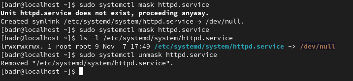

### 3.5 Arrêt par envoi de signal système (`systemctl kill`) et relance

```bash
sudo systemctl kill sshd
systemctl status sshd
sudo systemctl start sshd
```

**Analyse :** La commande `systemctl kill sshd` envoie par défaut le signal `SIGTERM` (signal 15) à tous les processus du groupe de contrôle du service. L'inspection du statut montre que le processus `5609` a capté le signal 15 et s'est arrêté proprement (`Active: inactive (dead)`, `status=0/SUCCESS`, `Deactivated successfully`). Le service est ensuite redémarré via `systemctl start sshd`.

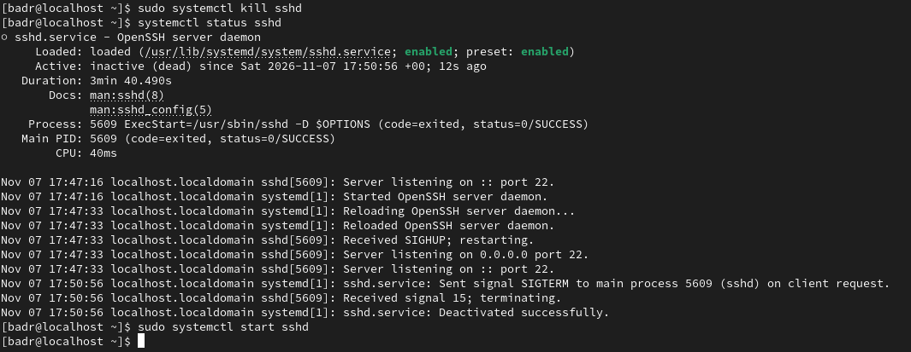

---

## Atelier 4 : Exploitation des Journaux Système avec Journalctl

### 4.1 Consultation des journaux du démarrage courant (`-b`) et par unité (`-u`)

```bash
journalctl -b -n 15
journalctl -u sshd.service -n 15
```

**Analyse :** L'option `-b` restreint l'affichage aux événements survenus depuis le dernier démarrage du système (renouvellements DHCP sur `ens192` avec l'adresse `192.168.27.130` et activité de `gnome-shell`). L'option `-u sshd.service` filtre exclusivement les entrées générées par le démon OpenSSH, retraçant le rechargement `SIGHUP` à `17:47:33`, l'arrêt `SIGTERM` à `17:50:56` et le redémarrage sous le PID `5890` à `17:51:21`.

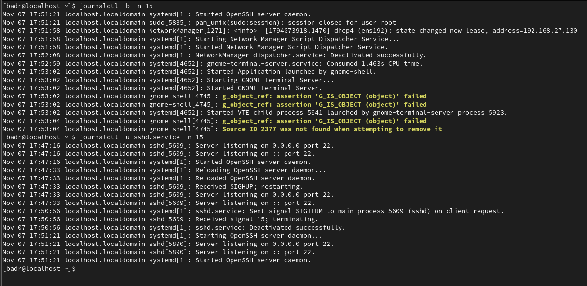

### 4.2 Surveillance en temps réel du flux d'événements (`-f`)

```bash
journalctl -u sshd.service -f
```

**Analyse :** Combinée avec le filtre d'unité, l'option `-f` (*follow*) maintient le curseur actif en fin de journal et affiche en direct toute nouvelle ligne de log produite par `sshd.service`, facilitant le débogage interactif lors des tests de connexion.

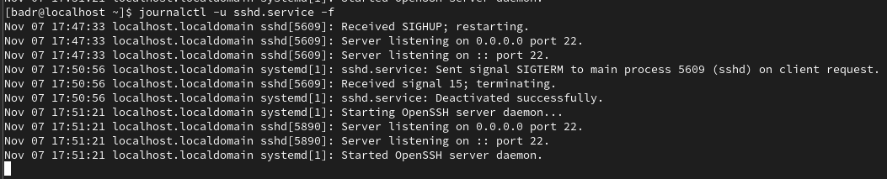

### 4.3 Filtrage par niveau de sévérité syslog (`-p err` / `-p warning`)

```bash
journalctl -p err -n 10
journalctl -p warning -n 10
```

**Analyse :** Le drapeau `-p` filtre les entrées selon les niveaux de priorité standards de syslog (de `0 emerg` à `7 debug`). Avec `-p err` (priorité 3 et plus graves), seules les erreurs critiques apparaissent en rouge (contrôleur SMBus `piix4_smbus`, initialisation audio `alsactl`, erreurs `gdm-password`). Avec `-p warning` (priorité 4 et plus graves), s'ajoutent en jaune les avertissements de synchronisation temporelle `chronyd` et du démon temps-réel `rtkit-daemon`.

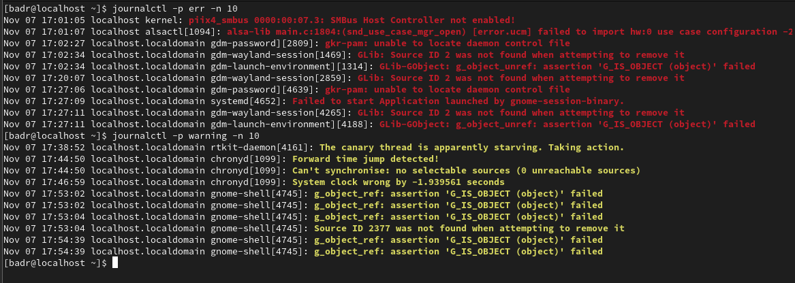

### 4.4 Filtrage temporel (`--since`) et limitation du nombre de lignes (`-n`)

```bash
journalctl --since "today" -n 15
journalctl --since "17:00" -n 10
```

**Analyse :** L'argument `--since` accepte des expressions relatives (`"today"`) ou des horodatages précis (`"17:00"`, `"YYYY-MM-DD HH:MM:SS"`). Associé à `-n`, il permet d'inspecter le début de la séquence d'initialisation du noyau Linux `5.14.0-687.61.1.el9_8.x86_64` et la cartographie mémoire physique `BIOS-e820` enregistrée à `17:01:00`.

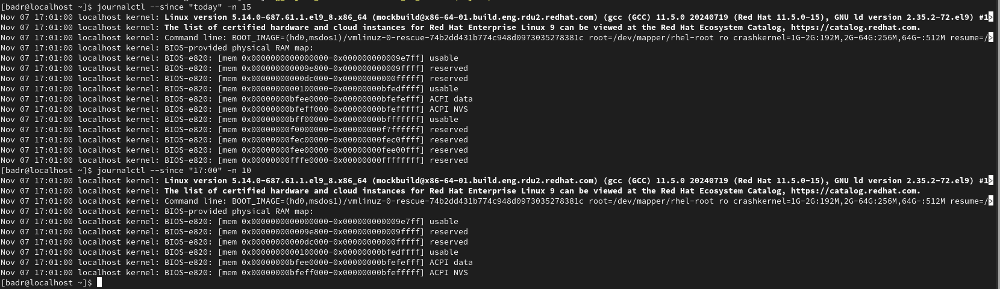

### 4.5 Formats de sortie structurés (`-o cat` et `-o json-pretty`)

```bash
journalctl -u sshd.service -o cat -n 5
journalctl -u sshd.service -o json-pretty -n 1
```

**Analyse :** L'option `-o` modifie le formateur de sortie de `journalctl`. Le mode `-o cat` supprime toutes les colonnes d'en-tête (date, hôte, PID) pour ne conserver que la chaîne de texte brute. À l'inverse, le mode `-o json-pretty` restitue l'objet JSON complet stocké par `journald` avec l'ensemble de ses champs d'audit (`_PID`, `_UID`, `_GID`, `_CMDLINE`, `_SYSTEMD_CGROUP`, `_SELINUX_CONTEXT`, `_BOOT_ID`, `PRIORITY`, `MESSAGE_ID`), facilitant l'ingestion par des collecteurs SIEM ou Elasticsearch.

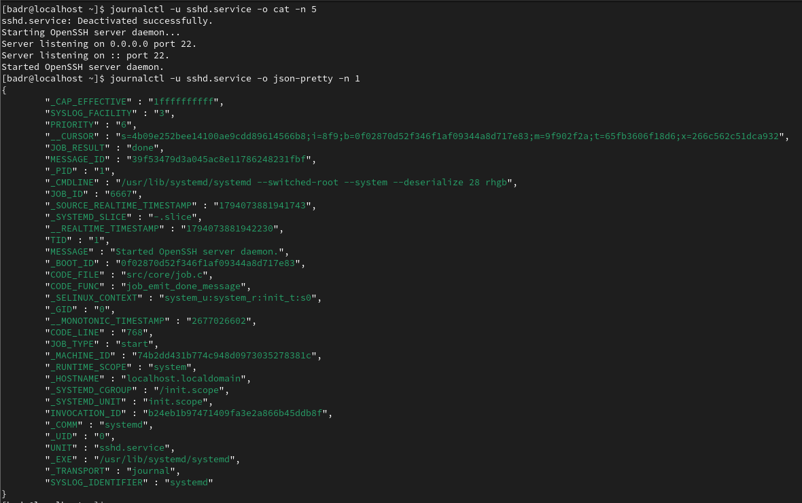

---

## Conclusion Générale

L'ensemble des manipulations réalisées au cours de ces quatre ateliers sur Red Hat Enterprise Linux 9.8 (Plow) a permis de maîtriser le fonctionnement interne de **systemd (v252)**. Nous avons vérifié son rôle central en tant que processus racine (PID 1), mesuré finement les performances d'amorçage avec `systemd-analyze` (19.215s au total), piloté le basculement à chaud entre les cibles `graphical.target` et `multi-user.target`, administré le cycle de vie complet des démons système (`sshd`, `crond`, `httpd`) et exploité les capacités de filtrage multicritères et d'export JSON de `journalctl` pour le diagnostic et la supervision.
