# TP n° 4 — Atelier 1 : Gestion de paquetages en utilisant `rpm`

**École :** École Marocaine des Sciences de l'Ingénieur (EMSI)  
**Module :** Administration Unix — **Niveau :** 4IIR  
**Professeure :** Mme Berraho Sanae  
**Environnement :** Red Hat Enterprise Linux 9 (`RHEL 9 x86_64`)  
**Utilisateur :** `badr@localhost`  

---

## Objectif de l'Atelier 1
Maîtriser le gestionnaire de paquetages de bas niveau **RPM (`Red Hat Package Manager`)** sous RHEL 9 : interrogation de la base de données locale, inspection des fichiers et métadonnées d'un paquetage, vérification de l'intégrité et de la signature GPG, installation manuelle, suppression et analyse des dépendances.

---

## Question 1 : Liste complète et nombre des paquetages installés

**Consigne :** Afficher la liste complète des paquetages installés sur le système. Combien y en a-t-il ?

### Commandes exécutées
```bash
rpm -qa
rpm -qa | wc -l
```

### Explication et Résultat
- L'option `-q` (*query*) combinée à `-a` (*all*) interroge la base RPM pour lister tous les paquetages installés.
- Le tube `| wc -l` compte le nombre exact de lignes retournées.
- **Résultat obtenu :** Il y a **1198 paquetages** installés sur le système RHEL 9.

### Captures d'écran
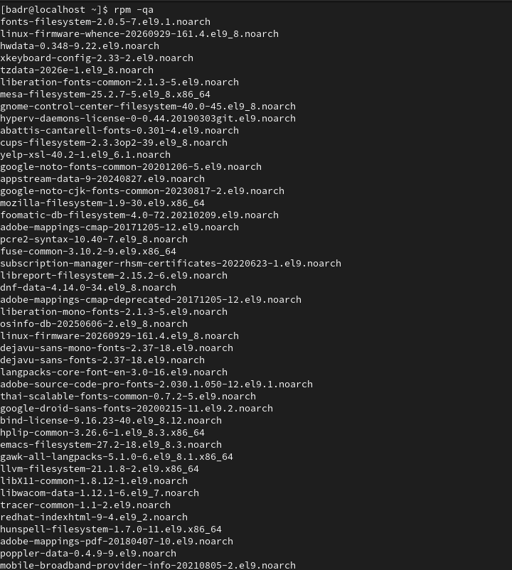


---

## Question 2 : Vérification et informations du paquetage `binutils`

**Consigne :** Le paquetage `binutils` est-il installé ? Si oui, afficher les informations concernant ce paquetage.

### Commandes exécutées
```bash
rpm -q binutils
rpm -qi binutils
```

### Explication et Résultat
- **Oui**, le paquetage est installé en version **`binutils-2.35.2-72.el9.x86_64`**.
- `rpm -qi binutils` affiche sa fiche descriptive complète : licence `GPLv3+`, taille (`25 215 155` octets), date d'installation et résumé (*A GNU collection of binary utilities* : `ar`, `as`, `ld`, `nm`, `objdump`, `readelf`, `strip`, etc.).

### Captures d'écran


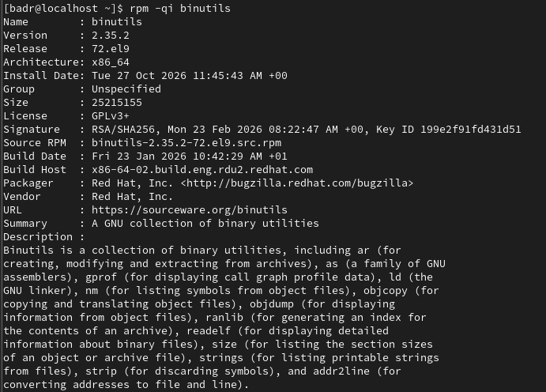

---

## Question 3 : Liste des fichiers appartenant au paquetage `binutils`

**Consigne :** Lister les fichiers appartenant au paquetage `binutils`.

### Commandes exécutées
```bash
rpm -ql binutils
rpm -ql binutils | head -n 20
rpm -ql binutils | wc -l
```

### Explication et Résultat
- L'option `-ql` (*query list*) affiche l'ensemble des chemins installés par `binutils` (exécutables dans `/usr/bin/`, bibliothèques, pages de manuel et fichiers de traduction).
- Le paquetage `binutils` fournit un total de **334 fichiers**.

### Captures d'écran
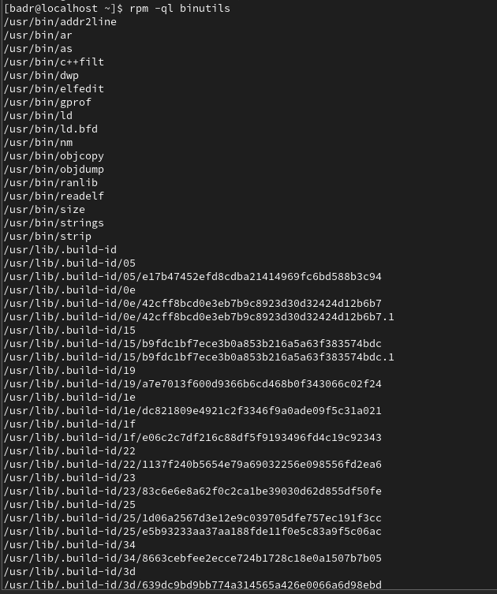

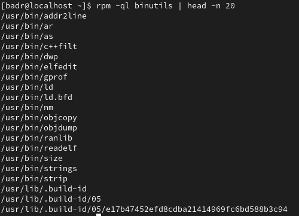

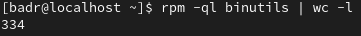

---

## Question 4 : Paquetage d'origine du fichier `/etc/services`

**Consigne :** De quel paquetage RPM provient le fichier `/etc/services` ?

### Commande exécutée
```bash
rpm -qf /etc/services
```

### Explication et Résultat
- L'option `-qf` (*query file*) recherche dans la base RPM le paquetage propriétaire d'un fichier du système.
- Le fichier `/etc/services` appartient au paquetage **`setup-2.13.7-10.el9.noarch`**.

### Capture d'écran
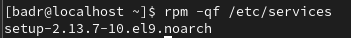

---

## Question 5 : Vérification de l'intégrité des paquetages `nfs-utils` et `pam`

**Consigne :** Quels fichiers appartenant aux paquetages `nfs-utils` et `pam` ont été modifiés depuis l'installation du système ? Sur quels points diffèrent-ils des fichiers originaux ?

### Commandes exécutées
```bash
sudo rpm -V nfs-utils
sudo rpm -V pam
```

### Explication et Résultat
- L'option `-V` (*Verify*) compare les attributs actuels des fichiers du paquetage avec les métadonnées d'origine stockées dans la base RPM.
- **`nfs-utils` :** Le paquetage n'est pas installé sur le système (`package nfs-utils is not installed`).
- **`pam` :** Cinq fichiers de configuration (`c`) présentent l'indicateur **`....L....`** :
  - `/etc/pam.d/fingerprint-auth`
  - `/etc/pam.d/password-auth`
  - `/etc/pam.d/postlogin`
  - `/etc/pam.d/smartcard-auth`
  - `/etc/pam.d/system-auth`
- **Signification du code `L` (*readLink*) :** La cible du lien symbolique diffère de celle d'origine (sous RHEL 9, ces fichiers sont gérés dynamiquement par `authselect` vers `/etc/authselect/`).

### Capture d'écran
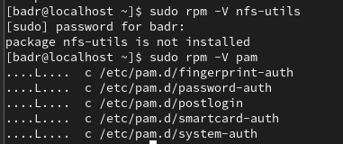

---

## Question 6 : Téléchargement du paquetage `zsh` et fichiers de configuration

**Consigne :** Télécharger le paquetage `zsh` à partir du lien indiqué. Quels sont les fichiers de configuration accompagnant ce paquetage ?

### Commandes exécutées
```bash
wget https://rpmfind.net/linux/centos-stream/10-stream/BaseOS/x86_64/os/Packages/zsh-5.9-14.el10.x86_64.rpm
rpm -qpc zsh-5.9-14.el10.x86_64.rpm
```

### Explication et Résultat
- L'archive `zsh-5.9-14.el10.x86_64.rpm` (3.35 Mo) est téléchargée avec `wget`.
- L'interrogation d'un fichier `.rpm` local non installé s'effectue avec `-p` (*package file*) combiné à `-c` (*configfiles*).
- Les fichiers de configuration fournis par `zsh` sont :
  - `/etc/skel/.zprofile` et `/etc/skel/.zshrc`
  - `/etc/zlogin`, `/etc/zlogout`, `/etc/zprofile`, `/etc/zshenv` et `/etc/zshrc`

### Capture d'écran
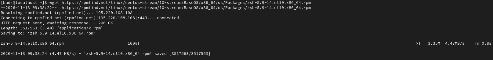

---

## Question 7 : Vérification de la signature électronique de l'archive `zsh`

**Consigne :** Vérifier la signature électronique de l'archive du paquetage `zsh`.

### Commandes exécutées
```bash
rpm -K zsh-5.9-14.el10.x86_64.rpm
rpm -Kv zsh-5.9-14.el10.x86_64.rpm
```

### Explication et Résultat
- L'option `-K` (`--checksig`) vérifie les sommes de contrôle cryptographiques et la signature GPG du fichier `.rpm`.
- Les sommes de contrôle (`Header SHA256 digest: OK`, `Payload SHA256 digest: OK`, `MD5 digest: OK`) sont **valides** : le fichier n'est pas corrompu.
- La signature RSA/SHA256 retourne **`NOKEY`** (`SIGNATURES NOT OK`) car le paquetage provient de CentOS Stream 10 (`key ID 8483c65d`), dont la clé publique GPG n'est pas importée dans le trousseau RPM de la machine RHEL 9.

### Captures d'écran
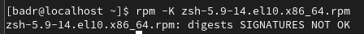

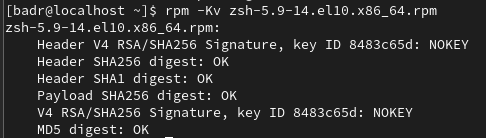

---

## Question 8 : Installation du paquetage `zsh` sans vérification des dépendances

**Consigne :** Installer le paquetage `zsh`. Utiliser l'option `--nodeps` pour ignorer les erreurs de dépendances.

### Commande exécutée
```bash
sudo rpm -ivh --nodeps zsh-5.9-14.el10.x86_64.rpm
```

### Explication et Résultat
- `-i` (*install*), `-v` (*verbose*), `-h` (*hash* : barre de progression).
- L'option `--nodeps` contourne la vérification des dépendances (notamment les versions de `glibc` propres à `el10`), permettant l'installation complète à 100 %.

### Capture d'écran
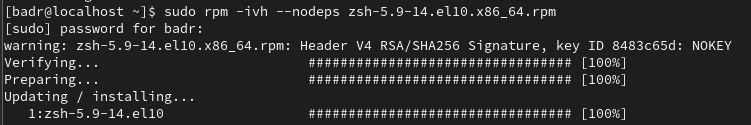

---

## Question 9 : Vérification de l'installation de `zsh`

**Consigne :** Vérifier que le paquetage `zsh` est installé.

### Commande exécutée
```bash
rpm -q zsh
```

### Explication et Résultat
- La base RPM confirme que **`zsh-5.9-14.el10.x86_64`** est bien installé.

### Capture d'écran


---

## Question 10 : Liste des fichiers fournis par `zsh`

**Consigne :** Afficher la liste des fichiers fournis par `zsh`.

### Commandes exécutées
```bash
rpm -ql zsh | head -n 20
rpm -ql zsh | wc -l
```

### Explication et Résultat
- On retrouve en tête de liste les fichiers d'initialisation (`/etc/skel/.zprofile`, `/etc/skel/.zshrc`, `/etc/zlogin`, `/etc/zlogout`, `/etc/zprofile`, `/etc/zshenv`, `/etc/zshrc`) ainsi que le binaire `/usr/bin/zsh`.
- Le paquetage `zsh` installe au total **1475 fichiers**.

### Capture d'écran
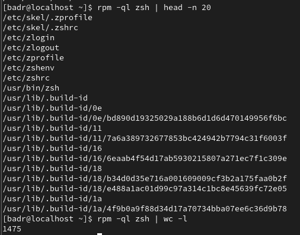

---

## Question 11 : Désinstallation du paquetage `zsh`

**Consigne :** Désinstaller le paquetage `zsh`.

### Commandes exécutées
```bash
sudo rpm -ev zsh
rpm -q zsh
```

### Explication et Résultat
- L'option `-e` (*erase*) suivie de `-v` (*verbose*) désinstalle le paquetage `zsh`.
- La vérification `rpm -q zsh` confirme : `package zsh is not installed`.

### Capture d'écran
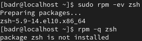

---

## Question 12 : Paquetage fournissant la commande `/bin/ls`

**Consigne :** Déterminer le nom du paquetage installé qui fournit la commande `/bin/ls`.

### Commande exécutée
```bash
rpm -qf /bin/ls
```

### Explication et Résultat
- La commande `/bin/ls` est fournie par le paquetage **`coreutils-8.32-41.el9_8.1.x86_64`**.

### Capture d'écran


---

## Question 13 : Téléchargement et tentative d'installation de `wireshark`

**Consigne :** Télécharger le paquetage `wireshark` sur le site web `https://rpmfind.net/`. Installer le paquetage. Pourquoi ne peut-on pas l'installer ?

### Commandes exécutées
```bash
PKG=$(curl -s "https://rpmfind.net/linux/centos-stream/9-stream/AppStream/x86_64/os/Packages/" | grep -oE 'wireshark-[0-9][^"]*\.x86_64\.rpm' | head -n 1)
wget "https://rpmfind.net/linux/centos-stream/9-stream/AppStream/x86_64/os/Packages/${PKG}"
sudo rpm -ivh wireshark-*.rpm
```

### Explication et Résultat
- Le paquetage `wireshark-3.4.10-6.el9.x86_64.rpm` est téléchargé depuis `rpmfind.net`.
- Lors de l'exécution de `sudo rpm -ivh wireshark-*.rpm`, l'installation échoue avec l'erreur **`error: Failed dependencies:`** car plusieurs bibliothèques et paquets requis sont absents :
  - `libQt5Core.so.5()(64bit)`, `libQt5Gui.so.5()(64bit)`, `libQt5Multimedia.so.5()(64bit)`, `libQt5PrintSupport.so.5()(64bit)`, `libQt5Widgets.so.5()(64bit)`
  - `libwireshark.so.14()(64bit)`, `libwiretap.so.11()(64bit)`, `libwsutil.so.12()(64bit)`
  - `wireshark-cli = 1:3.4.10-6.el9`
- **Pourquoi ne peut-on pas l'installer avec `rpm` ?**  
  `rpm` est un gestionnaire de paquetages de bas niveau qui opère uniquement sur des fichiers locaux : il vérifie la présence des dépendances dans la base locale mais **ne sait pas résoudre ni télécharger automatiquement les dépendances manquantes depuis des dépôts distants**. C'est précisément ce rôle que remplissent les gestionnaires de haut niveau comme **`dnf` / `yum`** (objet de l'Atelier 2).

### Capture d'écran
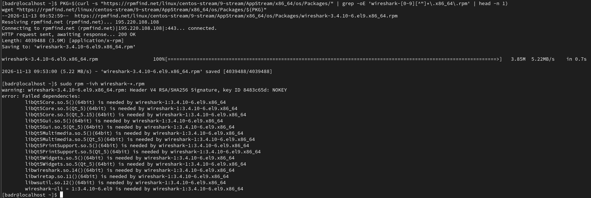

---

## Tableau récapitulatif des commandes `rpm` de l'Atelier 1

| Question | Objectif | Commande `rpm` utilisée | Résultat clé |
| :--- | :--- | :--- | :--- |
| **Q1** | Lister et compter tous les paquets installés | `rpm -qa` / `rpm -qa \| wc -l` | `1198` paquetages installés |
| **Q2** | Vérifier et afficher les infos de `binutils` | `rpm -q binutils` / `rpm -qi binutils` | `binutils-2.35.2-72.el9.x86_64` |
| **Q3** | Lister les fichiers de `binutils` | `rpm -ql binutils` | `334` fichiers installés |
| **Q4** | Identifier le paquet de `/etc/services` | `rpm -qf /etc/services` | `setup-2.13.7-10.el9.noarch` |
| **Q5** | Vérifier les fichiers modifiés (`nfs-utils`, `pam`) | `sudo rpm -V nfs-utils` / `sudo rpm -V pam` | `nfs-utils` absent ; 5 liens (`L`) dans `/etc/pam.d/` |
| **Q6** | Télécharger `zsh` et voir ses fichiers de config | `wget ...` / `rpm -qpc zsh-*.rpm` | `/etc/zshrc`, `/etc/zprofile`, `/etc/zshenv`, etc. |
| **Q7** | Vérifier la signature de l'archive `zsh` | `rpm -K zsh-*.rpm` / `rpm -Kv zsh-*.rpm` | Sommes SHA256/MD5 `OK`, clé GPG `NOKEY` |
| **Q8** | Installer `zsh` en ignorant les dépendances | `sudo rpm -ivh --nodeps zsh-*.rpm` | Installation forcée réussie (100 %) |
| **Q9** | Vérifier l'installation de `zsh` | `rpm -q zsh` | `zsh-5.9-14.el10.x86_64` |
| **Q10** | Lister les fichiers fournis par `zsh` | `rpm -ql zsh` | `1475` fichiers installés |
| **Q11** | Désinstaller `zsh` | `sudo rpm -ev zsh` | Paquetage supprimé |
| **Q12** | Identifier le paquet de `/bin/ls` | `rpm -qf /bin/ls` | `coreutils-8.32-41.el9_8.1.x86_64` |
| **Q13** | Tenter d'installer `wireshark` avec `rpm` | `sudo rpm -ivh wireshark-*.rpm` | Échec : `Failed dependencies` (Qt5, `wireshark-cli`) |
