# TP n° 4 — Atelier 2 : Installation et gestion de paquetages en utilisant `yum` / `dnf`

**École :** École Marocaine des Sciences de l'Ingénieur (EMSI)  
**Module :** Administration Unix — **Niveau :** 4IIR  
**Professeure :** Mr. Noreddine Abghour  
**Environnement :** Red Hat Enterprise Linux 9 (`RHEL 9 x86_64`)  
**Utilisateur :** `badr@localhost`  

---

## Objectif de l'Atelier 2
Maîtriser le gestionnaire de paquetages de haut niveau **DNF (`Dandified YUM`)** sous RHEL 9 : installation avec résolution automatique des dépendances, vérification et mise à jour du système, gestion de l'historique et annulation de transactions, interrogation des métadonnées et fournisseurs de fichiers, manipulation des groupes de paquets et gestion des dépôts logiciels.

---

## Question 1 : Vérifier si le paquet `dnf` est déjà installé

**Consigne :** Vérifier si le paquet dnf est déjà installé.

### Commandes exécutées
```bash
rpm -q dnf
dnf --version
```

### Explication et Résultat
- La commande rpm -q dnf interroge directement la base de données RPM locale et confirme que le paquetage dnf-4.14.0-34.el9_8.noarch est installé nativement sur le système.
- La commande dnf --version affiche la version 4.14.0 ainsi que la version de rpm sous-jacente (4.16.1.3-40.el9).
- Sur RHEL 9, dnf est le gestionnaire de paquetages principal par défaut ; la commande yum reste disponible en tant que lien symbolique pointant vers dnf pour assurer la rétrocompatibilité.

### Capture d'écran
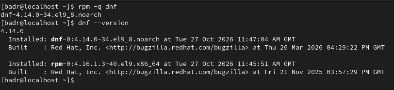

---

## Question 2 : Installer le paquetage `wireshark` en utilisant `dnf`

**Consigne :** Installer le paquetage wireshark qui posait un problème avec ses dépendances précédemment en utilisant cette fois dnf.

### Commande exécutée
```bash
sudo dnf install wireshark
```

### Explication et Résultat
- Contrairement à rpm -ivh (Atelier 1) qui échouait avec des erreurs de dépendances manquantes, dnf analyse automatiquement les métadonnées des dépôts configurés et résout l'ensemble de l'arbre de dépendances.
- DNF planifie l'installation de 14 paquetages (wireshark-3.4.10-14.el9_9.x86_64 ainsi que ses 13 dépendances : wireshark-cli, libsmi, openal-soft, pcre2-utf16, qt5-qtbase, qt5-qtgui, qt5-qtdeclarative, qt5-qtmultimedia et les bibliothèques xcb-util-*) depuis le dépôt rhel-9-for-x86_64-appstream-rpms (42 Mo téléchargés, 179 Mo installés).
- Lors du premier téléchargement, dnf importe et valide les clés publiques GPG officielles de Red Hat (/etc/pki/rpm-gpg/RPM-GPG-KEY-redhat-release) avant de finaliser l'installation (Complete!).

### Captures d'écran
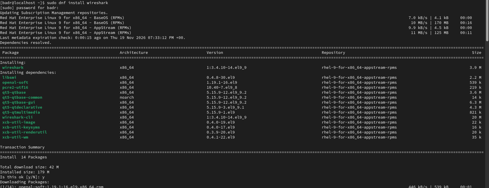

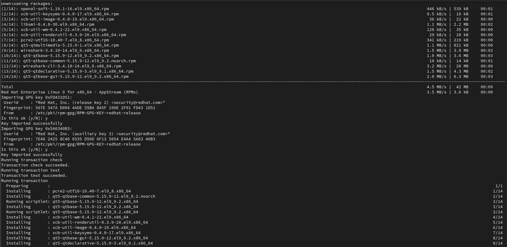

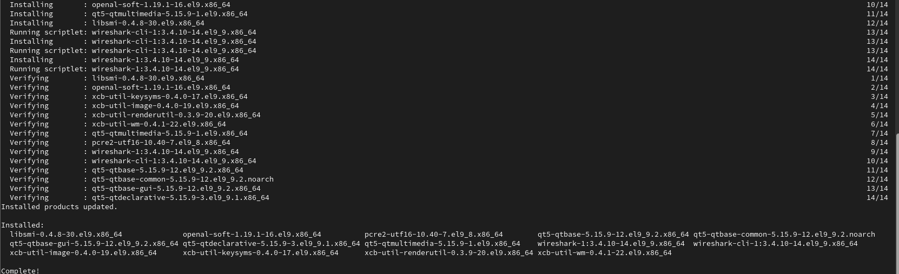

---

## Question 3 : Vérifier que `wireshark` est bien installé

**Consigne :** Vérifier que wireshark est bien installé.

### Commandes exécutées
```bash
rpm -q wireshark
dnf list installed wireshark
```

### Explication et Résultat
- rpm -q wireshark confirme l'enregistrement du paquetage wireshark-3.4.10-14.el9_9.x86_64 dans la base RPM locale.
- dnf list installed wireshark précise également le dépôt d'origine de l'installation : @rhel-9-for-x86_64-appstream-rpms.

### Capture d'écran
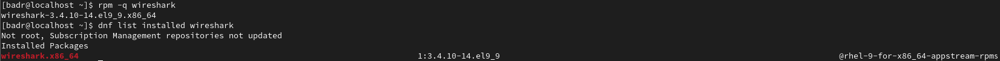

---

## Question 4 : Vérifier la présence de mises à jour dans les dépôts

**Consigne :** Vérifier la présence de mises à jour dans les différents dépôts pour les paquetages actuellement installés.

### Commande exécutée
```bash
sudo dnf check-update
```

### Explication et Résultat
- La commande dnf check-update synchronise les métadonnées des dépôts actifs (BaseOS et AppStream) et compare les versions disponibles avec celles installées sur le système.
- Elle retourne la liste complète des paquetages pouvant être mis à jour (NetworkManager, bind, cockpit, python3, systemd, kernel, etc.) sans modifier le système.

### Capture d'écran
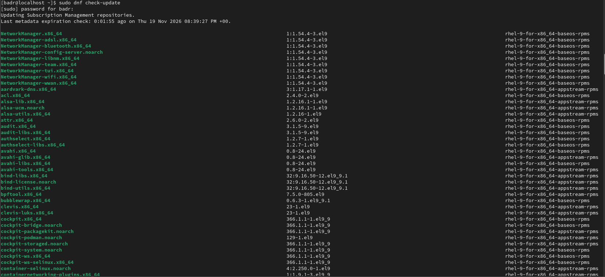

---

## Question 5 : Effectuer une mise à jour des paquetages du système

**Consigne :** Effectuer une mise à jour des paquetages du système si vous possédez une bande passante suffisante.

### Commande exécutée
```bash
sudo dnf upgrade
```

### Explication et Résultat
- La commande sudo dnf upgrade télécharge et installe toutes les dernières versions disponibles des paquetages du système.
- La transaction installe 8 nouveaux paquetages (dont le nouveau noyau kernel-5.14.0-741.24.1.el9_9 et ses modules) et met à niveau 395 paquetages existants pour un volume total de 1,4 Go.
- Après téléchargement et exécution des scripts post-installation, la mise à jour se termine avec succès (Complete!).

### Captures d'écran
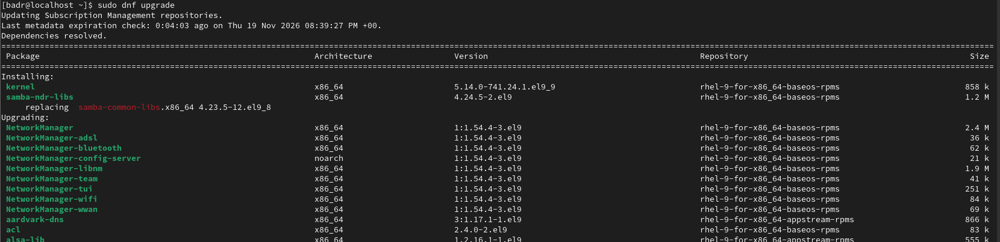

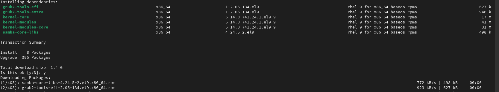

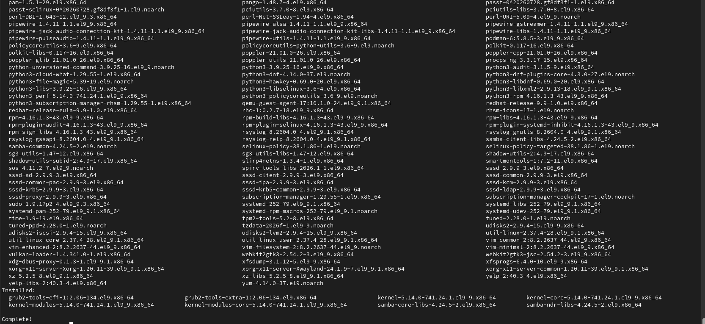

---

## Question 6 : Afficher l'historique `dnf`, inspecter la transaction `wireshark` et l'annuler

**Consigne :** Afficher l'historique de la commande dnf, puis afficher les informations détaillées sur la transaction qui a installé wireshark. Finalement, annuler cette transaction.

### Commandes exécutées
```bash
sudo dnf history list
sudo dnf history info 2
sudo dnf history undo 2
```

### Explication et Résultat
- sudo dnf history list affiche l'historique complet des transactions DNF : on repère que la commande install wireshark correspond à la transaction ID 2 (14 paquetages modifiés).
- sudo dnf history info 2 affiche les détails complets de cette transaction (date, utilisateur, code de retour Success, liste exacte des 14 paquetages installés depuis @rhel-9-for-x86_64-appstream-rpms).
- sudo dnf history undo 2 inverse proprement la transaction en désinstallant wireshark ainsi que ses 13 dépendances, libérant 179 Mo d'espace disque.

### Captures d'écran
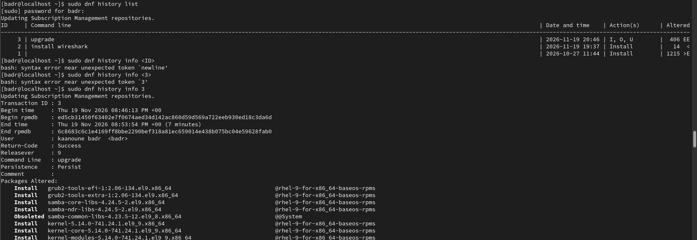

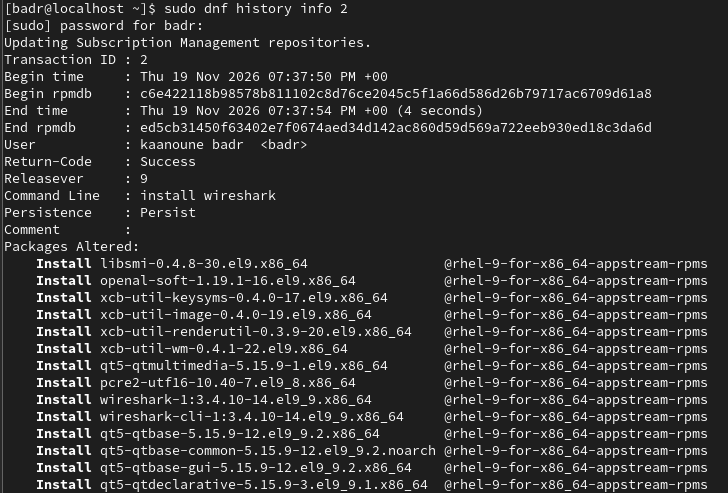

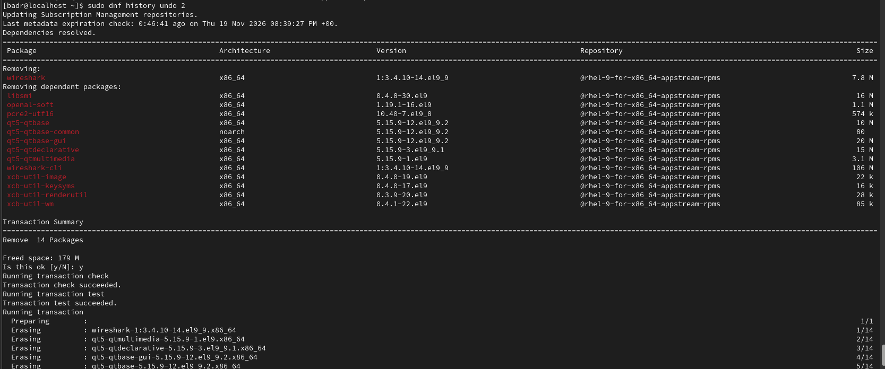

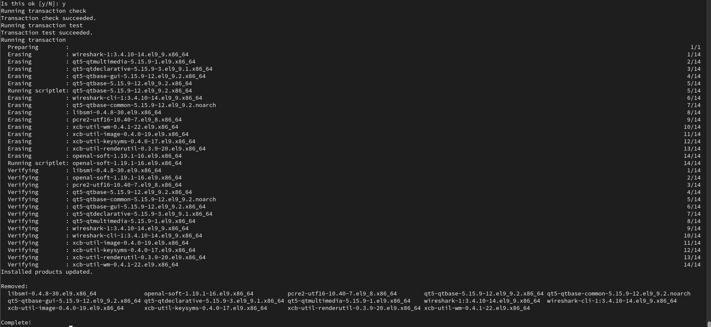

---

## Question 7 : Obtenir les informations sur le paquetage `zsh` (installé ou non)

**Consigne :** Obtenir les informations sur le paquetage zsh, qu'il soit installé ou non.

### Commande exécutée
```bash
dnf info zsh
```

### Explication et Résultat
- Contrairement à rpm -qi qui ne fonctionne que sur les paquetages déjà installés, dnf info interroge les métadonnées des dépôts distants.
- Bien que zsh ne soit pas installé sur la machine, DNF affiche sa fiche complète sous la section Available Packages : version 5.8-9.el9, architecture x86_64, taille 3.2 M, dépôt rhel-9-for-x86_64-baseos-rpms, licence MIT et description.

### Capture d'écran
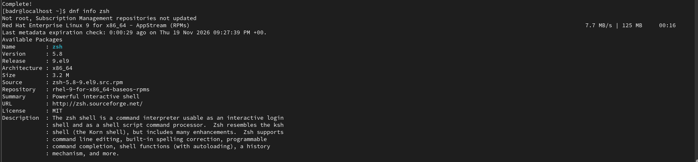

---

## Question 8 : Trouver le nom des paquetages fournissant le fichier `/usr/share/magic`

**Consigne :** Trouver le nom des paquetages fournissant le fichier /usr/share/magic.

### Commandes exécutées
```bash
dnf provides /usr/share/magic
dnf provides */magic
```

### Explication et Résultat
- La commande dnf provides recherche dans les listes de fichiers des dépôts quel paquetage fournit un chemin ou une commande donnée.
- Le fichier /usr/share/magic est fourni par le paquetage file-libs (versions 5.39-8.el9 à 5.39-12.1.el9_2, architectures x86_64 et i686) dans le dépôt rhel-9-for-x86_64-baseos-rpms.

### Captures d'écran
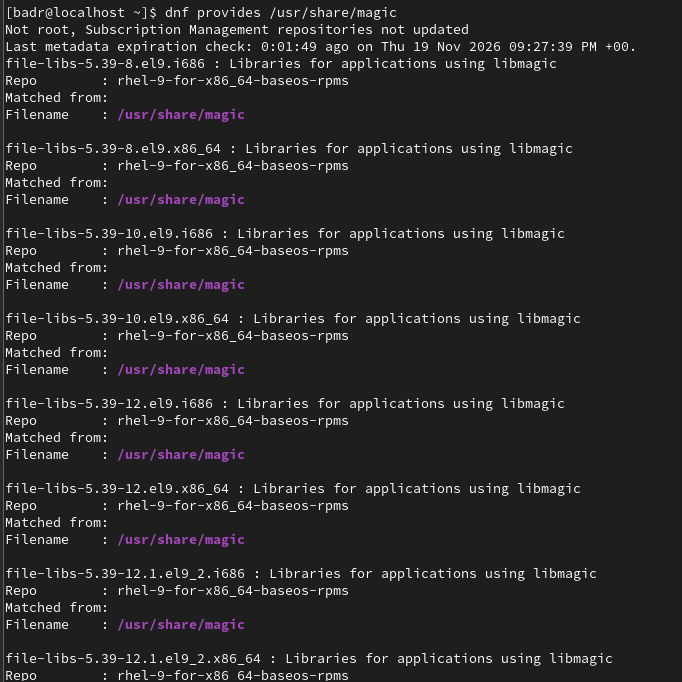

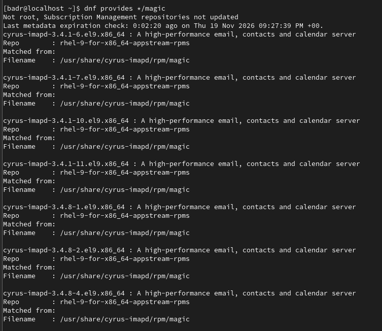

---

## Question 9 : Afficher la liste des groupes de paquets

**Consigne :** Afficher la liste des groupes de paquets.

### Commande exécutée
```bash
dnf group list
```

### Explication et Résultat
- Un groupe de paquets rassemble plusieurs logiciels dédiés à une même fonction afin de faciliter leur installation ou suppression globale.
- dnf group list distingue les groupes d'environnements installés (Server with GUI) et disponibles (Server, Minimal Install, Workstation...), ainsi que les groupes de paquets disponibles, dont System Tools.

### Capture d'écran
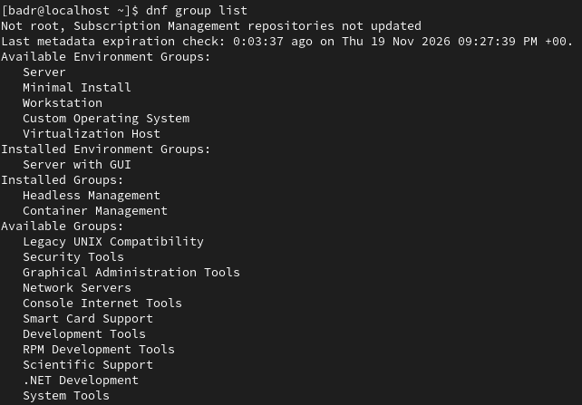

---

## Question 10 : Afficher les informations du groupe `'System Tools'`

**Consigne :** Afficher les informations du groupe 'System Tools'.

### Commande exécutée
```bash
dnf group info "System Tools"
```

### Explication et Résultat
- La commande dnf group info "System Tools" détaille la description du groupe ainsi que la liste de ses paquetages par défaut (chrony, cifs-utils, libreswan, nmap, openldap-clients, samba-client, tigervnc, tmux, zsh, etc.) et optionnels.

### Capture d'écran
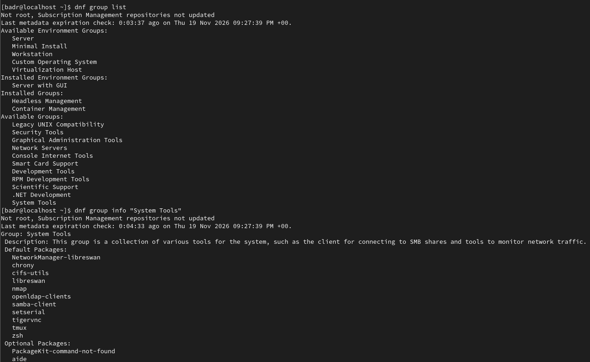

---

## Question 11 : Installer le groupe de paquets `'System Tools'`

**Consigne :** Installer le groupe de paquets 'System Tools'.

### Commande exécutée
```bash
sudo dnf group install "System Tools"
```

### Explication et Résultat
- La commande sudo dnf group install "System Tools" installe en une seule transaction les 18 paquetages par défaut et dépendances du groupe (nmap, tmux, zsh, tigervnc, cifs-utils, samba-client, etc.).

### Captures d'écran
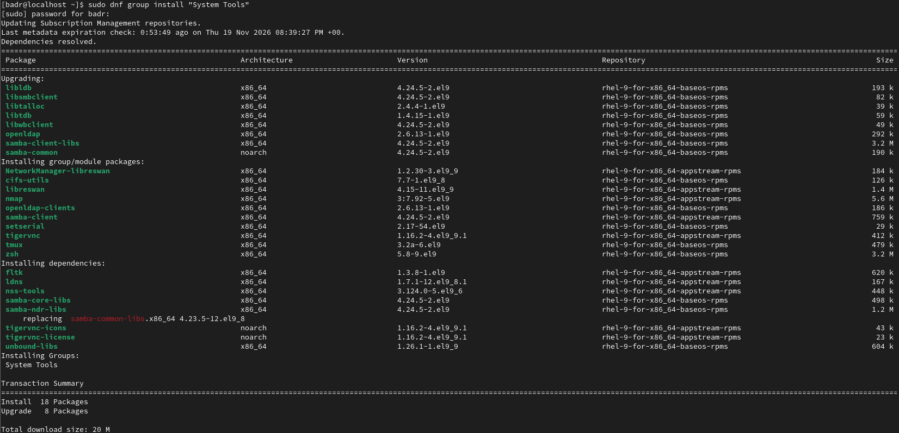

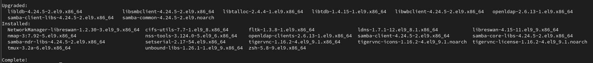

---

## Question 12 : Désinstaller le groupe de paquets `'System Tools'`

**Consigne :** Désinstaller le groupe de paquets 'System Tools'.

### Commande exécutée
```bash
sudo dnf group remove "System Tools"
```

### Explication et Résultat
- La commande sudo dnf group remove "System Tools" désinstalle proprement le groupe ainsi que ses 16 paquetages et dépendances inutilisées, libérant 48 Mo d'espace disque.

### Captures d'écran
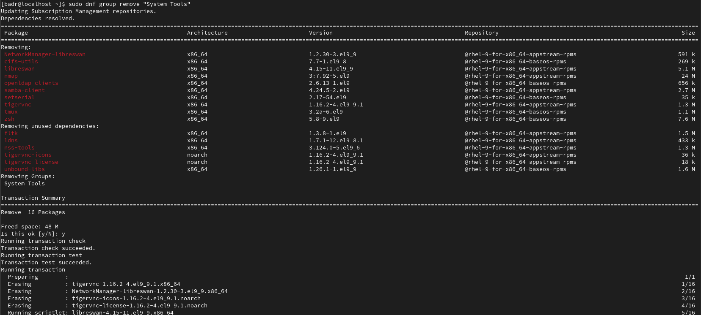

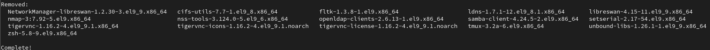

---

## Question 13 : Afficher la liste des dépôts actifs dans votre système

**Consigne :** Afficher la liste des dépôts actifs dans votre système.

### Commande exécutée
```bash
dnf repolist
```

### Explication et Résultat
- La commande dnf repolist interroge les fichiers .repo présents dans /etc/yum.repos.d/ et liste les dépôts activés (enabled=1).
- Deux dépôts officiels Red Hat sont actifs sur le système RHEL 9 : rhel-9-for-x86_64-appstream-rpms et rhel-9-for-x86_64-baseos-rpms.

### Capture d'écran
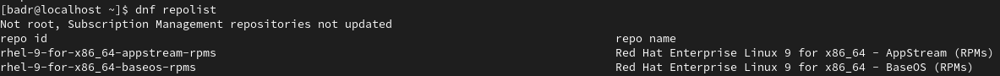

---

## Question 14 : Éditer le fichier de configuration des dépôts officiels de RHEL 9

**Consigne :** Éditer le fichier de configuration des dépôts officiels de RHEL (adapté à RHEL 9).

### Commande exécutée
```bash
sudo vi /etc/yum.repos.d/redhat.repo
```

### Explication et Résultat
- Sur RHEL 9, les dépôts officiels gérés par Subscription Manager sont définis dans le fichier /etc/yum.repos.d/redhat.repo.
- Chaque section [...] décrit un dépôt avec son identifiant, son nom, son URL de base (baseurl), son état d'activation (enabled = 1 ou 0) et ses paramètres de vérification GPG/SSL.

### Capture d'écran
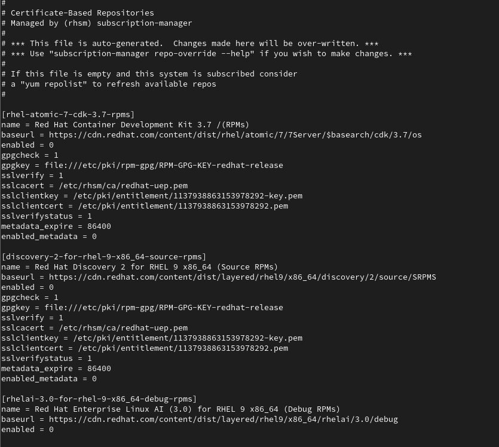

---

## Questions 15 & 16 : Désactiver le dépôt `rhel-9-for-x86_64-appstream-rpms` et vérifier les dépôts actifs

**Consigne :** Désactiver à partir du fichier précédent le dépôt rhel-9-for-x86_64-appstream-rpms (Q15), puis vérifier de nouveau la liste des dépôts actifs (Q16).

### Commandes exécutées
```bash
sudo sed -i '/^\[rhel-9-for-x86_64-appstream-rpms\]/,/^\[/ s/^enabled = 1/enabled = 0/' /etc/yum.repos.d/redhat.repo
grep -A 4 "\[rhel-9-for-x86_64-appstream-rpms\]" /etc/yum.repos.d/redhat.repo
dnf repolist
```

### Explication et Résultat
- Question 15 : Dans la section [rhel-9-for-x86_64-appstream-rpms] de /etc/yum.repos.d/redhat.repo, le paramètre enabled = 1 est modifié en enabled = 0.
- Question 16 : L'exécution de dnf repolist confirme que le dépôt AppStream n'apparaît plus ; seul le dépôt rhel-9-for-x86_64-baseos-rpms demeure actif.

### Capture d'écran
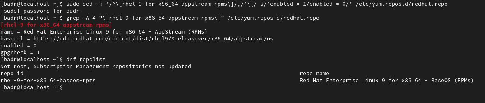

---

## Question 17 : Réactiver le dépôt `rhel-9-for-x86_64-appstream-rpms` avec `config-manager`

**Consigne :** Réactiver le dépôt rhel-9-for-x86_64-appstream-rpms en utilisant cette fois yum-config-manager.

### Commandes exécutées
```bash
sudo yum-config-manager --enable rhel-9-for-x86_64-appstream-rpms
sudo dnf config-manager --set-enabled rhel-9-for-x86_64-appstream-rpms
dnf repolist
```

### Explication et Résultat
- Sur RHEL 9 sans le paquetage optionnel yum-utils, la commande yum-config-manager retourne command not found et est remplacée nativement par le plugin dnf config-manager.
- L'exécution de sudo dnf config-manager --set-enabled rhel-9-for-x86_64-appstream-rpms repasse automatiquement enabled = 1 dans redhat.repo.
- La commande dnf repolist confirme ensuite que les deux dépôts officiels (rhel-9-for-x86_64-appstream-rpms et rhel-9-for-x86_64-baseos-rpms) sont à nouveau actifs.

### Captures d'écran
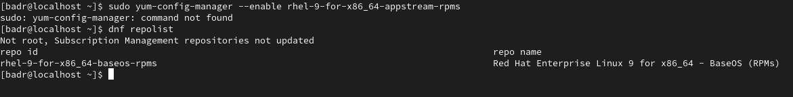

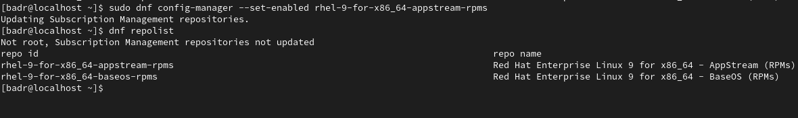

---

## Tableau récapitulatif des commandes `dnf` de l'Atelier 2

| Question | Objectif | Commande `dnf` utilisée | Résultat clé |
| :--- | :--- | :--- | :--- |
| **Q1** | Vérifier la présence et la version de dnf | `rpm -q dnf / dnf --version` | dnf-4.14.0-34.el9_8.noarch installé |
| **Q2** | Installer wireshark avec ses dépendances | `sudo dnf install wireshark` | 14 paquetages installés depuis AppStream |
| **Q3** | Vérifier que wireshark est installé | `rpm -q wireshark / dnf list installed wireshark` | wireshark-3.4.10-14.el9_9.x86_64 (@appstream) |
| **Q4** | Lister les mises à jour disponibles | `sudo dnf check-update` | Liste des paquets à mettre à jour affichée |
| **Q5** | Mettre à jour les paquetages du système | `sudo dnf upgrade` | 8 paquets installés + 395 mis à jour (1,4 Go) |
| **Q6** | Consulter l'historique et annuler wireshark | `dnf history list / info 2 / undo 2` | Transaction ID 2 inspectée puis annulée (179 Mo) |
| **Q7** | Afficher les infos de zsh (même non installé) | `dnf info zsh` | zsh-5.8-9.el9.x86_64 (3.2 Mo, BaseOS) |
| **Q8** | Trouver le paquet fournissant /usr/share/magic | `dnf provides /usr/share/magic` | file-libs (dépôt BaseOS) |
| **Q9** | Afficher la liste des groupes de paquets | `dnf group list` | Groupes listés (dont System Tools) |
| **Q10** | Afficher les détails du groupe System Tools | `dnf group info "System Tools"` | Paquets par défaut (nmap, tmux, zsh, etc.) |
| **Q11** | Installer le groupe System Tools | `sudo dnf group install "System Tools"` | 18 paquetages installés avec succès |
| **Q12** | Désinstaller le groupe System Tools | `sudo dnf group remove "System Tools"` | 16 paquetages supprimés (48 Mo libérés) |
| **Q13** | Lister les dépôts actifs | `dnf repolist` | appstream-rpms et baseos-rpms actifs |
| **Q14** | Éditer la configuration des dépôts officiels | `sudo vi /etc/yum.repos.d/redhat.repo` | Fichier redhat.repo inspecté |
| **Q15 & 16** | Désactiver AppStream et vérifier repolist | `enabled = 0 dans redhat.repo + dnf repolist` | Seul rhel-9-for-x86_64-baseos-rpms reste actif |
| **Q17** | Réactiver AppStream en ligne de commande | `sudo dnf config-manager --set-enabled ...` | Les 2 dépôts officiels sont de nouveau actifs |
