# TP n° 4 — Atelier 3 : Créer un dépôt de logiciels local

**École :** École Marocaine des Sciences de l'Ingénieur (EMSI)  
**Module :** Administration Unix — **Niveau :** 4IIR  
**Professeure :** Mme Berraho Sanae  
**Environnement :** Red Hat Enterprise Linux 9 (`RHEL 9 x86_64`)  
**Utilisateur :** `badr@localhost`  

---

## Objectif de l'Atelier 3
Mettre en place un **dépôt de logiciels local** sous Red Hat Enterprise Linux 9 à l'aide du serveur web **Apache (`httpd`)**, de **`dnf` / `yum`** et de l'outil d'indexation **`createrepo` (`createrepo_c`)**, puis valider l'installation hors-ligne d'un paquetage complexe (**`wireshark`** et ses 13 dépendances) exclusivement depuis ce dépôt local.

---

## Question 1 : Installer le paquetage `httpd` pour mettre en place Apache

**Consigne :** Installer le paquetage httpd pour mettre en place Apache.

### Commande exécutée
```bash
sudo dnf install httpd
```

### Explication et Résultat
- Le paquetage httpd installe le serveur web Apache HTTP Server sous Red Hat Enterprise Linux 9.
- DNF résout automatiquement l'arbre des dépendances et installe 11 paquetages (httpd-2.4.62-13.el9_8.9.x86_64, httpd-core, httpd-filesystem, httpd-tools, apr, apr-util, mod_http2, mod_lua, etc.) depuis le dépôt rhel-9-for-x86_64-appstream-rpms.
- L'installation crée automatiquement l'arborescence /var/www/html/, qui servira de répertoire racine pour héberger et distribuer notre dépôt local.

### Captures d'écran
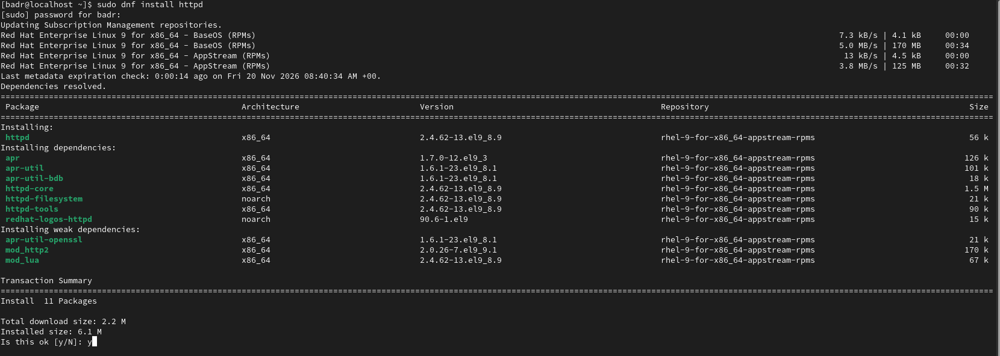

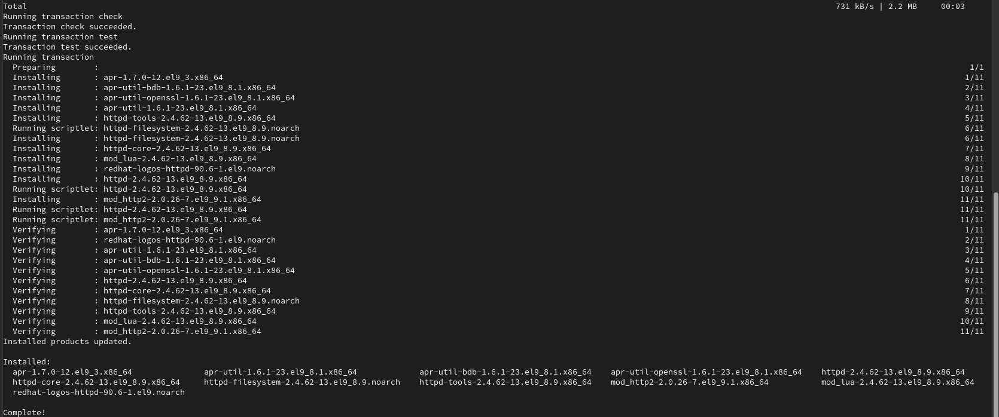

---

## Question 2 : Créer un répertoire pour le dépôt de logiciel local

**Consigne :** Créer un répertoire pour le dépôt de logiciel local en utilisant la commande : mkdir /var/www/html/mon_depot.

### Commandes exécutées
```bash
sudo mkdir -p /var/www/html/mon_depot
ls -ld /var/www/html/mon_depot
```

### Explication et Résultat
- La commande sudo mkdir -p /var/www/html/mon_depot crée le sous-répertoire dédié au stockage des archives .rpm et des métadonnées du dépôt dans l'arborescence d'Apache.
- La vérification avec ls -ld confirme que le répertoire existe avec les permissions drwxr-xr-x et appartient à root:root.

### Capture d'écran
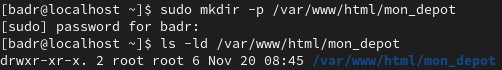

---

## Question 3 : Télécharger le paquetage `wireshark` et ses dépendances sans les installer

**Consigne :** Afin d’alimenter le dépôt local, télécharger un package RPM en utilisant la commande : yum install --downloadonly --downloaddir=/var/www/html/mon_depot wireshark.

### Commande exécutée
```bash
sudo yum install --downloadonly --downloaddir=/var/www/html/mon_depot wireshark
```

### Explication et Résultat
- L'option --downloadonly demande à yum/dnf de résoudre toutes les dépendances de wireshark et de télécharger les 14 archives .rpm nécessaires (wireshark-3.4.10-14.el9_9.x86_64 ainsi que wireshark-cli, libsmi, qt5-*, xcb-util-*, etc., pour un total de 42 Mo) sans procéder à leur installation.
- Remarque technique RHEL 9 : sous RHEL 9, yum install --downloadonly peut conserver les paquets dans le cache système (/var/cache/dnf/) ; la sous-commande dnf download --resolve --destdir=/var/www/html/mon_depot garantit la copie directe des 14 fichiers .rpm dans le répertoire cible (voir Question 4).

### Captures d'écran
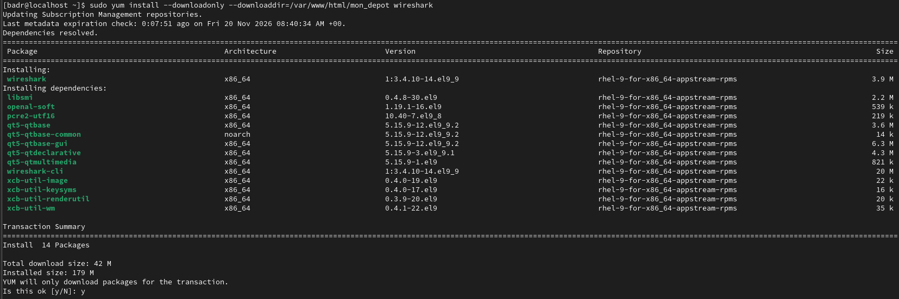

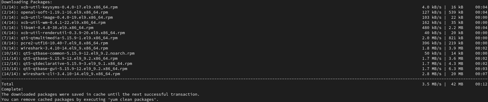

---

## Question 4 : Créer les métadonnées du dépôt de paquetages avec `createrepo`

**Consigne :** Créer le dépôt de paquetages en utilisant la commande : createrepo /var/www/html/mon_depot.

### Commandes exécutées
```bash
sudo dnf install -y createrepo_c
sudo dnf download --resolve --destdir=/var/www/html/mon_depot wireshark
sudo createrepo /var/www/html/mon_depot
ls -lh /var/www/html/mon_depot
```

### Explication et Résultat
- Sous RHEL 9, l'outil createrepo est fourni par le paquetage createrepo_c (installé via sudo dnf install -y createrepo_c).
- Après avoir placé les 14 fichiers .rpm directement dans /var/www/html/mon_depot via dnf download --resolve --destdir, l'exécution de sudo createrepo /var/www/html/mon_depot analyse l'ensemble des 14 paquetages (Directory walk done - 14 packages).
- La commande génère automatiquement le sous-répertoire repodata/ (contenant repomd.xml et les bases SQLite d'indexation), transformant le dossier brut en un véritable dépôt exploitable par DNF.

### Captures d'écran
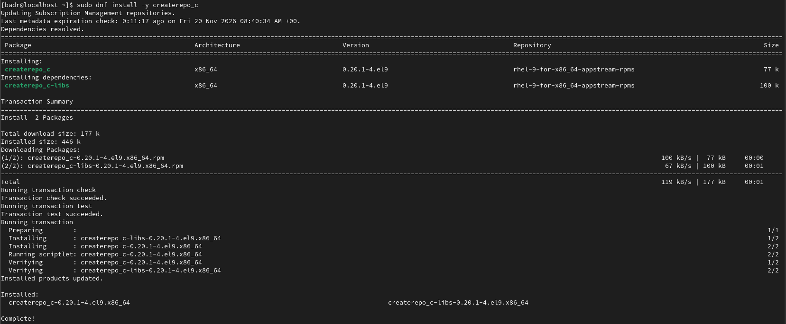

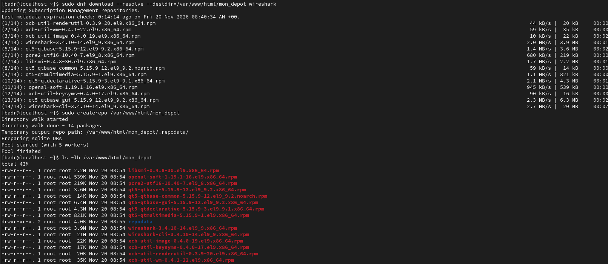

---

## Question 5 : Configurer le fichier de dépôt `/etc/yum.repos.d/mon_depot.repo`

**Consigne :** Configurer le dépôt pour qu'il soit accessible en éditant /etc/yum.repos.d/mon_depot.repo avec les paramètres [mon_depot], name, baseurl, gpgcheck=0 et enabled=1.

### Commandes exécutées
```bash
sudo gedit /etc/yum.repos.d/mon_depot.repo
# Contenu enregistré :
# [mon_depot]
# name=Mon Depot Local
# baseurl=file:///var/www/html/mon_depot
# gpgcheck=0
# enabled=1
dnf repolist
```

### Explication et Résultat
- Tous les dépôts logiciels sont déclarés dans des fichiers d'extension .repo placés dans le répertoire /etc/yum.repos.d/.
- Le paramètre baseurl=file:///var/www/html/mon_depot indique à DNF d'accéder directement au répertoire local du système de fichiers, tandis que gpgcheck=0 désactive la vérification de signature GPG et enabled=1 active immédiatement le dépôt.
- L'exécution de dnf repolist confirme que le dépôt local mon_depot (Mon Depot Local) est immédiatement reconnu et actif aux côtés des dépôts officiels Red Hat.

### Captures d'écran
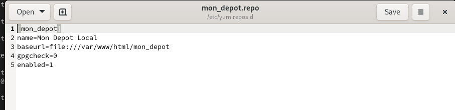

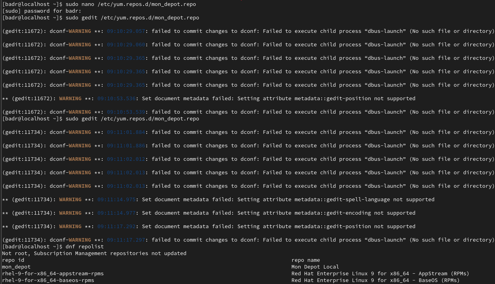

---

## Question 6 : Désactiver temporairement les deux dépôts officiels de Red Hat

**Consigne :** Désactiver temporairement les deux dépôts officiels de Red Hat.

### Commandes exécutées
```bash
sudo dnf config-manager --set-disabled rhel-9-for-x86_64-appstream-rpms rhel-9-for-x86_64-baseos-rpms
dnf repolist
```

### Explication et Résultat
- Afin de prouver que l'installation de wireshark s'effectuera exclusivement depuis notre dépôt local sans accès aux serveurs Red Hat distants, nous désactivons rhel-9-for-x86_64-appstream-rpms et rhel-9-for-x86_64-baseos-rpms.
- La commande dnf repolist confirme qu'un seul dépôt demeure actif sur la station RHEL 9 : mon_depot (Mon Depot Local).

### Capture d'écran
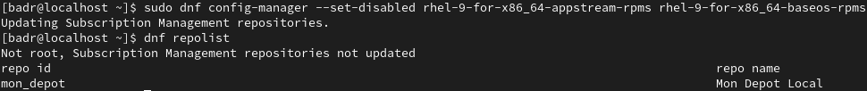

---

## Question 7 : Installer `wireshark` depuis le dépôt local et vérifier sa provenance

**Consigne :** Installer maintenant wireshark et vérifier si l’installation est effectuée à partir du dépôt local.

### Commandes exécutées
```bash
sudo dnf install wireshark
dnf list installed wireshark
# Remise en état des dépôts officiels après validation :
sudo dnf config-manager --set-enabled rhel-9-for-x86_64-appstream-rpms rhel-9-for-x86_64-baseos-rpms
dnf repolist
```

### Explication et Résultat
- Lors de l'exécution de sudo dnf install wireshark, la colonne Repository du tableau de transaction indique mon_depot pour wireshark ainsi que pour chacune de ses 13 dépendances (14 paquetages au total, 42 Mo).
- L'installation se déroule hors-ligne à grande vitesse depuis /var/www/html/mon_depot et se conclut avec succès (Complete!).
- La commande dnf list installed wireshark confirme la présence du paquetage installé, puis les deux dépôts officiels Red Hat sont réactivés proprement via dnf config-manager --set-enabled.

### Captures d'écran
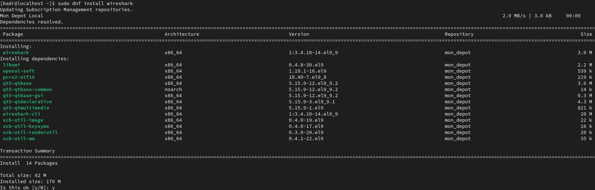

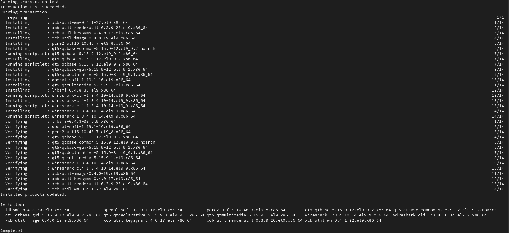

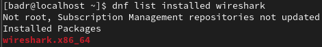

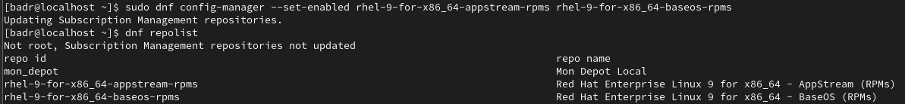

---

## Tableau récapitulatif des étapes de l'Atelier 3

| Étape | Objectif | Commande clé utilisée | Résultat obtenu |
| :--- | :--- | :--- | :--- |
| **Q1** | Installer le serveur web Apache (httpd) | `sudo dnf install httpd` | 11 paquetages installés (httpd-2.4.62) |
| **Q2** | Créer le répertoire du dépôt local | `sudo mkdir -p /var/www/html/mon_depot` | Dossier /var/www/html/mon_depot créé |
| **Q3** | Télécharger wireshark sans l'installer | `yum install --downloadonly --downloaddir=... wireshark` | 14 paquetages RPM téléchargés (42 Mo) |
| **Q4** | Générer les métadonnées du dépôt local | `sudo createrepo /var/www/html/mon_depot` | 14 paquetages indexés + dossier repodata/ |
| **Q5** | Déclarer le dépôt local dans /etc/yum.repos.d/ | `gedit /etc/yum.repos.d/mon_depot.repo` | mon_depot actif dans dnf repolist |
| **Q6** | Désactiver temporairement les dépôts Red Hat | `sudo dnf config-manager --set-disabled ...` | Seul mon_depot demeure actif |
| **Q7** | Installer wireshark depuis le dépôt local | `sudo dnf install wireshark` | 14 paquets installés depuis mon_depot |
