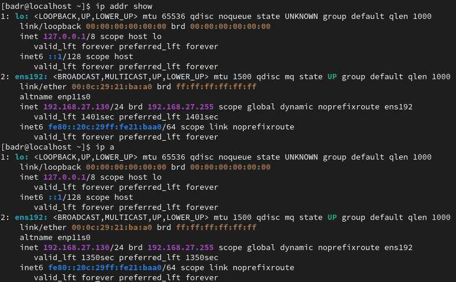
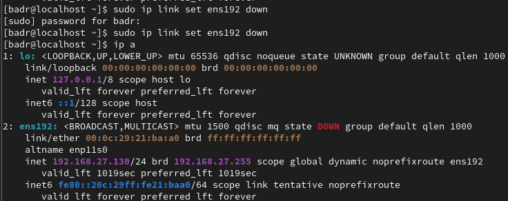
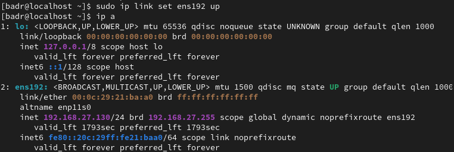
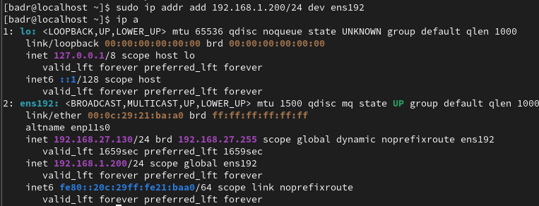
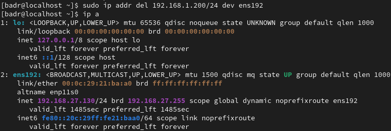
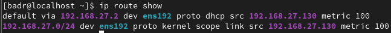
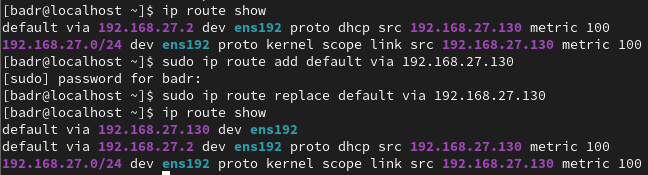

# TP n° 5 — Atelier 1 : Exploration de la commande classique `ip a`

**École :** École Marocaine des Sciences de l'Ingénieur (EMSI)  
**Module :** Administration Unix — **Niveau :** 4IIR  
**Professeure :** Mr. Noreddine Abghour  
**Environnement :** Red Hat Enterprise Linux 9.8 (`RHEL 9 x86_64` — Interface `ens192`)  
**Utilisateur :** `badr@localhost` (`rhel9-badr`)  
**Compte rendu PDF :** [`Compte_Rendu_TP5_Atelier1_ip.pdf`](./Compte_Rendu_TP5_Atelier1_ip.pdf)  

---

## Objectif — Atelier1
Maîtriser la suite d'outils réseau moderne iproute2 (commande ip) sous Red Hat Enterprise Linux 9 pour inspecter les interfaces réseau, contrôler leur état administratif (UP/DOWN), ajouter et supprimer temporairement des adresses IPv4, et manipuler la table de routage (passerelle par défaut).

---

## Étape 1 : Lister les interfaces réseau et repérer le nom de la carte réseau

**Consigne :** Exécuter ip addr show (ou son raccourci ip a) pour lister les interfaces réseau et repérer le nom de l'interface Ethernet.

### Commandes exécutées
```bash
ip addr show
ip a
```

### Explication et Résultat
- La commande ip a (raccourci de ip addr show) appartient à la suite iproute2, qui remplace progressivement l'ancien outil ifconfig.
- Deux interfaces sont détectées sur la station RHEL 9 : l'interface de bouclage locale lo (127.0.0.1/8 et ::1/128) et la carte Ethernet nommée ens192 (nom alternatif enp11s0).
- L'interface ens192 est à l'état UP (<BROADCAST,MULTICAST,UP,LOWER_UP>), dispose de l'adresse MAC 00:0c:29:21:ba:a0 et de l'adresse IPv4 dynamique (DHCP) 192.168.27.130/24 (broadcast 192.168.27.255).

### Capture d'écran


---

## Étape 2 : Désactiver l'interface réseau `ens192` et vérifier son état

**Consigne :** Désactiver l'interface réseau (ens192) avec ip link set, puis vérifier la modification avec ip a.

### Commandes exécutées
```bash
sudo ip link set ens192 down
ip a
```

### Explication et Résultat
- La commande sudo ip link set ens192 down désactive l'interface au niveau de la couche liaison, coupant immédiatement le trafic réseau sur cette carte.
- La sortie de ip a confirme que ens192 passe à state DOWN et que les drapeaux UP et LOWER_UP disparaissent de la ligne d'état (<BROADCAST,MULTICAST>).

### Capture d'écran


---

## Étape 3 : Réactiver l'interface réseau `ens192` et vérifier

**Consigne :** Activer l'interface réseau (ens192) avec ip link set, puis vérifier son état avec ip a.

### Commandes exécutées
```bash
sudo ip link set ens192 up
ip a
```

### Explication et Résultat
- La commande sudo ip link set ens192 up remet l'interface Ethernet en service.
- La commande ip a confirme le retour à state UP avec les drapeaux <BROADCAST,MULTICAST,UP,LOWER_UP> et l'adresse IPv4 192.168.27.130/24 opérationnelle.

### Capture d'écran


---

## Étape 4 : Configurer une adresse IP temporaire (`192.168.1.200/24`)

**Consigne :** Ajouter une adresse IP temporaire 192.168.1.200/24 sur ens192 et vérifier les adresses actives avec ip a.

### Commandes exécutées
```bash
sudo ip addr add 192.168.1.200/24 dev ens192
ip a
```

### Explication et Résultat
- La commande ip addr add attribue une nouvelle adresse IPv4 temporaire (non persistante après redémarrage) sur l'interface ens192.
- Cette opération n'écrase pas l'adresse existante : ip a affiche désormais simultanément l'adresse DHCP d'origine (192.168.27.130/24) et la nouvelle adresse manuelle (192.168.1.200/24, valid_lft forever).

### Capture d'écran


---

## Étapes 5 & 6 : Supprimer la deuxième adresse IP et vérifier avec `ip a`

**Consigne :** Supprimer l'adresse temporaire 192.168.1.200/24 de ens192 (Étape 5), puis relancer ip a pour vérifier la suppression (Étape 6).

### Commandes exécutées
```bash
sudo ip addr del 192.168.1.200/24 dev ens192
ip a
```

### Explication et Résultat
- La commande sudo ip addr del retire uniquement l'adresse IP et le masque spécifiés (192.168.1.200/24) de l'interface ens192.
- La vérification par ip a confirme la suppression propre de la deuxième adresse tout en conservant intacte l'adresse dynamique principale 192.168.27.130/24.

### Capture d'écran


---

## Étapes 7 & 8 : Configurer la passerelle par défaut et consulter `ip route show`

**Consigne :** Configurer la passerelle par défaut avec ip route (en utilisant l'adresse IP de l'interface réseau, soit 192.168.27.130, dans le cadre de cet atelier), puis vérifier la table de routage avec ip route show.

### Commandes exécutées
```bash
ip route show
sudo ip route add default via 192.168.27.130
sudo ip route replace default via 192.168.27.130
ip route show
```

### Explication et Résultat
- Avant modification, ip route show indique que la passerelle par défaut fournie par DHCP est 192.168.27.2 (métrique 100) sur ens192.
- Après exécution de sudo ip route add/replace default via 192.168.27.130, la nouvelle route par défaut (default via 192.168.27.130 dev ens192) apparaît en tête de la table de routage avec une métrique prioritaire (0) devant la route DHCP (métrique 100).
- Ces modifications effectuées via iproute2 restent temporaires en mémoire vive ; la route de test est ensuite retirée proprement avant d'entamer l'Atelier 2.

### Captures d'écran




---

## Tableau récapitulatif — Atelier1

| Étape | Objectif | Commande clé | Résultat obtenu |
| :--- | :--- | :--- | :--- |
| **Étape 1** | Identifier les interfaces et adresses IP | `ip addr show / ip a` | Interface ens192 (192.168.27.130/24, UP) |
| **Étape 2** | Désactiver l'interface Ethernet | `sudo ip link set ens192 down` | ens192 passe à state DOWN |
| **Étape 3** | Réactiver l'interface Ethernet | `sudo ip link set ens192 up` | ens192 repasse à state UP |
| **Étape 4** | Ajouter une IP temporaire | `sudo ip addr add 192.168.1.200/24 dev ens192` | 2 adresses IP actives sur ens192 |
| **Étapes 5 & 6** | Supprimer l'IP temporaire et vérifier | `sudo ip addr del 192.168.1.200/24 dev ens192` | Retour à l'unique IP 192.168.27.130/24 |
| **Étapes 7 & 8** | Configurer la route par défaut et vérifier | `sudo ip route add/replace default via 192.168.27.130` | Nouvelle route par défaut visible dans ip route show |
