# TP n° 5 — Atelier 2 : Exploration de l'outil `nmcli` et de l'interface `nmtui`

**École :** École Marocaine des Sciences de l'Ingénieur (EMSI)  
**Module :** Administration Unix — **Niveau :** 4IIR  
**Professeure :** Mr. Noreddine Abghour  
**Environnement :** Red Hat Enterprise Linux 9.8 (`RHEL 9 x86_64` — Interface `ens192`)  
**Utilisateur :** `badr@localhost` (`rhel9-badr`)  
**Compte rendu PDF :** [`Compte_Rendu_TP5_Atelier2_nmcli_nmtui.pdf`](./Compte_Rendu_TP5_Atelier2_nmcli_nmtui.pdf)  

---

## Objectif — Atelier2
Maîtriser l'administration persistante du réseau sous RHEL 9 à l'aide de NetworkManager (nmcli et nmtui) : distinguer périphériques (devices) et profils de connexion (connections), basculer entre adressage statique et DHCP, résoudre les doublons d'adresses IP, créer et activer plusieurs profils pour une même carte réseau (ens192-static et ens192-dhcp), et explorer l'outil semi-graphique nmtui.

---

## Étape 1 : Lister les périphériques réseau disponibles (`nmcli device status`)

**Consigne :** Lister les périphériques réseau disponibles sur la machine et identifier les interfaces gérées par NetworkManager.

### Commandes exécutées
```bash
sudo ip route del default via 192.168.27.130
nmcli device status
```

### Explication et Résultat
- Après suppression de la route temporaire de l'Atelier 1, nmcli device status affiche les périphériques détectés par NetworkManager.
- L'interface physique ens192 (type ethernet) est à l'état connected et utilise actuellement le profil de connexion nommé ens192 ; l'interface lo (type loopback) est à l'état connected (externally).

### Capture d'écran
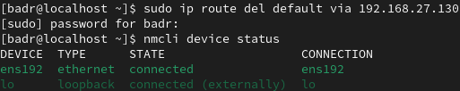

---

## Étape 2 : Désactiver l'interface réseau (`nmcli device disconnect`)

**Consigne :** Utiliser nmcli device disconnect pour désactiver l'interface réseau ens192 et observer l'impact sur la connectivité.

### Commandes exécutées
```bash
sudo nmcli device disconnect ens192
nmcli device status
ping -c 2 8.8.8.8
```

### Explication et Résultat
- NetworkManager confirme la déconnexion : Device 'ens192' successfully disconnected.
- Dans nmcli device status, l'interface ens192 passe à l'état disconnected sans aucun profil actif (--).
- Le test de connectivité ping -c 2 8.8.8.8 échoue immédiatement avec l'erreur ping: connect: Network is unreachable, démontrant la coupure complète de l'accès réseau.

### Capture d'écran
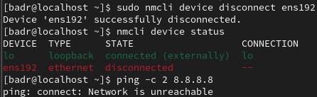

---

## Étape 3 : Reconnecter l'interface (`nmcli device connect`)

**Consigne :** Reconnecter l'interface ens192 et vérifier que l'accès au réseau est entièrement restauré.

### Commandes exécutées
```bash
sudo nmcli device connect ens192
nmcli device status
ping -c 2 8.8.8.8
```

### Explication et Résultat
- La commande sudo nmcli device connect ens192 réactive automatiquement le profil associé (UUID 5463d51a-fd37-3fa8-90ef-41c16bc830bb).
- nmcli device status affiche de nouveau ens192 à l'état connected.
- Le test ping -c 2 8.8.8.8 réussit avec 0 % de perte de paquets (2 paquets transmis et reçus en 28,1 ms et 49,2 ms), validant la restauration complète de la connectivité.

### Capture d'écran
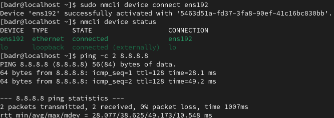

---

## Étape 4 : Lister tous les profils de connexion (`nmcli connection show`)

**Consigne :** Lister toutes les connexions réseau disponibles (profils) et leur état actuel (activé ou non).

### Commande exécutée
```bash
nmcli connection show
```

### Explication et Résultat
- La commande nmcli connection show affiche l'ensemble des profils enregistrés dans NetworkManager avec leur nom (NAME), leur identifiant unique (UUID), leur type (TYPE) et le périphérique associé (DEVICE).
- Deux profils actifs apparaissent en vert : ens192 (UUID 5463d51a-fd37-3fa8-90ef-41c16bc830bb, type ethernet) et lo (type loopback).

### Capture d'écran
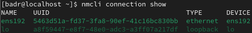

---

## Étapes 5 & 6 : Configurer le profil `ens192` en IP statique et vérifier

**Consigne :** Modifier le profil ens192 pour utiliser une configuration IP statique (192.168.1.100/24, passerelle 192.168.1.1, DNS 8.8.8.8, méthode manual), puis afficher ses paramètres pour vérifier la prise en compte.

### Commandes exécutées
```bash
sudo nmcli connection modify ens192 ipv4.addresses 192.168.1.100/24 ipv4.gateway 192.168.1.1 ipv4.dns 8.8.8.8 ipv4.method manual
nmcli connection show ens192 | grep -E "ipv4\.(method|addresses|gateway|dns):"
```

### Explication et Résultat
- Contrairement à ip addr add, nmcli connection modify enregistre durablement les paramètres dans le profil NetworkManager sur disque.
- La commande nmcli connection show ens192 confirme l'enregistrement des quatre paramètres : ipv4.method=manual, ipv4.addresses=192.168.1.100/24, ipv4.gateway=192.168.1.1 et ipv4.dns=8.8.8.8.

### Capture d'écran
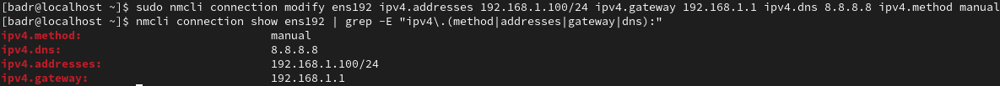

---

## Étapes 7 & 8 : Désactiver puis réactiver la connexion (`down` / `up`)

**Consigne :** Désactiver la connexion ens192 (Étape 7), puis la réactiver (Étape 8) afin d'appliquer la nouvelle configuration statique sur l'interface.

### Commandes exécutées
```bash
sudo nmcli connection down ens192
ip a
sudo nmcli connection up ens192
ip a
```

### Explication et Résultat
- Après sudo nmcli connection down ens192, la connexion est désactivée et l'ancienne adresse DHCP disparaît totalement de l'interface ens192 dans ip a.
- Après sudo nmcli connection up ens192, le profil modifié est rechargé et ip a confirme l'attribution de l'adresse IPv4 statique 192.168.1.100/24 (broadcast 192.168.1.255, valid_lft forever).

### Capture d'écran
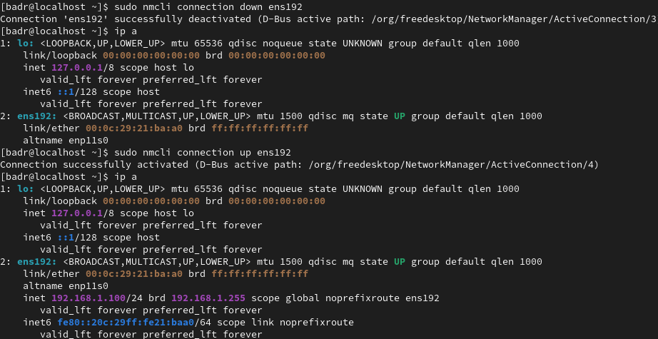

---

## Étapes 9, 10 & 11 : Revenir en mode DHCP (`auto`) et relancer NetworkManager

**Consigne :** Modifier le profil ens192 pour utiliser DHCP (ipv4.method auto), vérifier la configuration, puis réactiver NetworkManager (networking off/on) et observer le résultat avec ip a.

### Commandes exécutées
```bash
sudo nmcli connection modify ens192 ipv4.method auto
nmcli connection show ens192 | grep -E "ipv4\.(method|addresses|gateway|dns):"
sudo nmcli networking off
sudo nmcli networking on
ip a
```

### Explication et Résultat
- La commande nmcli connection show confirme que ipv4.method est passé à auto, mais les anciens champs statiques (192.168.1.100/24 et passerelle 192.168.1.1) restent présents dans le profil.
- Après nmcli networking off puis on, ip a révèle exactement le comportement signalé dans la Note de l'énoncé : ens192 porte simultanément deux adresses IPv4 — l'ancienne adresse statique (192.168.1.100/24) et la nouvelle adresse dynamique DHCP (192.168.27.130/24).

### Capture d'écran
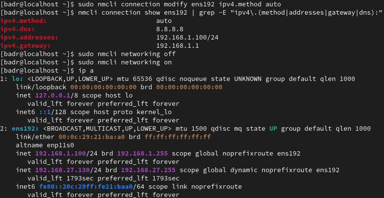

---

## Note (Nettoyage) : Note : Supprimer l'adresse IP statique en excès

**Consigne :** Supprimer la passerelle statique et l'adresse IP statique en excès afin de ne conserver que l'adresse IP dynamique attribuée par DHCP.

### Commandes exécutées
```bash
sudo nmcli connection modify ens192 ipv4.gateway ""
sudo nmcli connection modify ens192 -ipv4.addresses 192.168.1.100/24
sudo nmcli networking off
sudo nmcli networking on
ip a
```

### Explication et Résultat
- On efface d'abord la passerelle manuelle (ipv4.gateway "") avant de retirer l'adresse statique avec le préfixe de suppression (-ipv4.addresses 192.168.1.100/24).
- Après relance du réseau (networking off/on), ip a confirme que l'adresse 192.168.1.100/24 a disparu : seule l'adresse dynamique 192.168.27.130/24 subsiste sur ens192.

### Capture d'écran
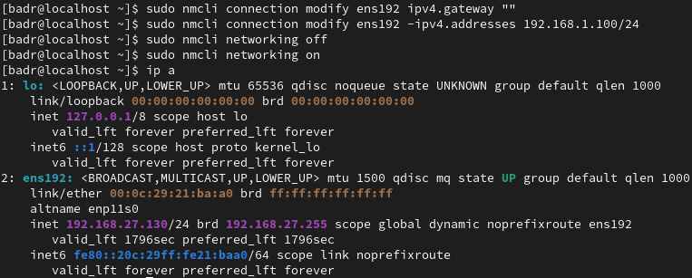

---

## Application (A, B & C) : Application (Parties A, B & C) : Créer deux profils pour `ens192`

**Consigne :** Créer un profil statique (ens192-static) et un profil dynamique (ens192-dhcp) associés à la même carte réseau ens192, puis vérifier leur création avec nmcli connection show.

### Commandes exécutées
```bash
sudo nmcli connection add type ethernet con-name "ens192-static" ifname ens192 ipv4.addresses 192.168.1.100/24 ipv4.gateway 192.168.1.1 ipv4.dns "8.8.8.8,1.1.1.1" ipv4.method manual
sudo nmcli connection add type ethernet con-name "ens192-dhcp" ifname ens192 ipv4.method auto
nmcli connection show
```

### Explication et Résultat
- Partie A : Création du profil ens192-static (UUID 1b178fe9-e6a0-4a41-a042-13de5b03b7b5) en mode manuel avec l'IP 192.168.1.100/24, la passerelle 192.168.1.1 et les serveurs DNS 8.8.8.8 et 1.1.1.1.
- Partie B : Création du profil ens192-dhcp (UUID ca5dcc71-de3d-4298-b1d7-297a5b12df09) configuré pour obtenir ses paramètres automatiquement par DHCP (ipv4.method auto).
- Partie C : nmcli connection show confirme que les deux nouveaux profils Ethernet existent aux côtés du profil initial ens192 (ils sont pour l'instant inactifs : DEVICE = --).

### Capture d'écran
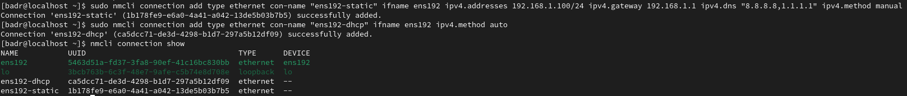

---

## Application (Partie D) : Application (Partie D) : Activer et basculer entre les deux profils

**Consigne :** Activer le profil statique ens192-static et vérifier avec ip a, basculer sur le profil dynamique ens192-dhcp et observer ip a, puis tester la désactivation avec nmcli connection down.

### Commandes exécutées
```bash
sudo nmcli connection up ens192-static
ip a
sudo nmcli connection up ens192-dhcp
ip a
sudo nmcli connection down ens192-dhcp
nmcli connection show
sudo nmcli connection up ens192-dhcp
```

### Explication et Résultat
- L'activation de ens192-static applique immédiatement l'adresse statique 192.168.1.100/24 sur la carte ens192 (confirmée par ip a).
- Le basculement vers ens192-dhcp remplace instantanément la configuration par l'adresse dynamique 192.168.27.130/24 (valid_lft 1796sec), permettant de retrouver l'accès Internet.
- Lors de la désactivation de ens192-dhcp (nmcli connection down), NetworkManager réactive automatiquement un autre profil configuré en autoconnect (ens192-static), avant que la commande finale nmcli connection up ens192-dhcp ne rétablisse le profil DHCP actif.

### Captures d'écran
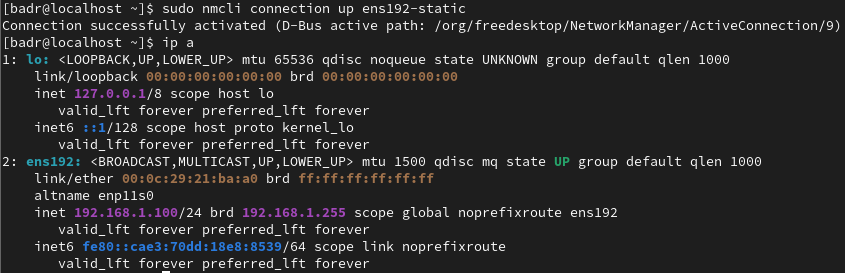

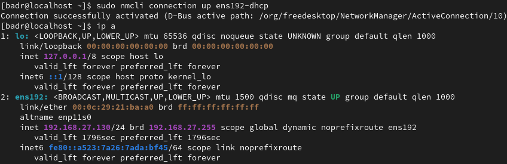

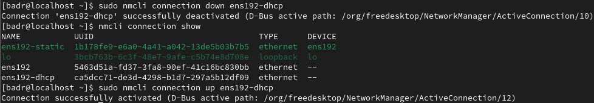

---

## Alternative (nmtui) : Alternative : Exploration de l'outil interactif `nmtui`

**Consigne :** Lancer sudo nmtui et explorer les options proposées (Modifier une connexion, Activer une connexion, Définir le nom d'hôte du système).

### Commande exécutée
```bash
sudo nmtui
```

### Explication et Résultat
- nmtui (NetworkManager Text User Interface) propose une interface semi-graphique navigable au clavier dans le terminal, idéale pour administrer un serveur sans environnement de bureau.
- Le menu principal regroupe les opérations essentielles : Edit a connection (créer/modifier un profil), Activate a connection (activer/désactiver), Set system hostname et Radio.
- Toutes les opérations réalisées dans nmtui modifient directement les mêmes profils NetworkManager que nmcli.

### Capture d'écran
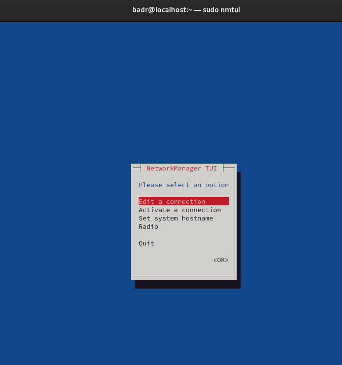

---

## Tableau récapitulatif — Atelier2

| Étape | Objectif | Commande clé | Résultat obtenu |
| :--- | :--- | :--- | :--- |
| **Étape 1** | Lister les périphériques gérés | `nmcli device status` | ens192 connected (profil ens192) |
| **Étape 2** | Déconnecter l'interface et tester | `sudo nmcli device disconnect ens192` | ens192 disconnected — Network is unreachable |
| **Étape 3** | Reconnecter l'interface et vérifier | `sudo nmcli device connect ens192` | ens192 connected — ping 8.8.8.8 OK (0% perte) |
| **Étape 4** | Lister les profils de connexion | `nmcli connection show` | Profils actifs : ens192 et lo |
| **Étapes 5 & 6** | Passer le profil ens192 en IP statique | `nmcli connection modify ens192 ... manual` | IP 192.168.1.100/24, GW 192.168.1.1, DNS 8.8.8.8 |
| **Étapes 7 & 8** | Appliquer le profil statique | `nmcli connection down / up ens192` | ens192 porte l'adresse statique 192.168.1.100/24 |
| **Étapes 9 à 11** | Basculer en DHCP et relancer le réseau | `nmcli con modify ... auto + networking off/on` | 2 IP actives (statique résiduelle + DHCP) |
| **Note** | Supprimer l'IP statique en excès | `nmcli con modify ens192 -ipv4.addresses ...` | Unique IP DHCP 192.168.27.130/24 conservée |
| **App. A, B & C** | Créer 2 profils pour ens192 | `nmcli connection add con-name ens192-static / dhcp` | Profils ens192-static et ens192-dhcp créés |
| **App. D** | Basculer entre profil statique et DHCP | `nmcli connection up / down ens192-static|dhcp` | Basculement instantané vérifié par ip a |
| **Alternative** | Explorer l'interface semi-graphique | `sudo nmtui` | Menus Edit, Activate et Hostname explorés |
